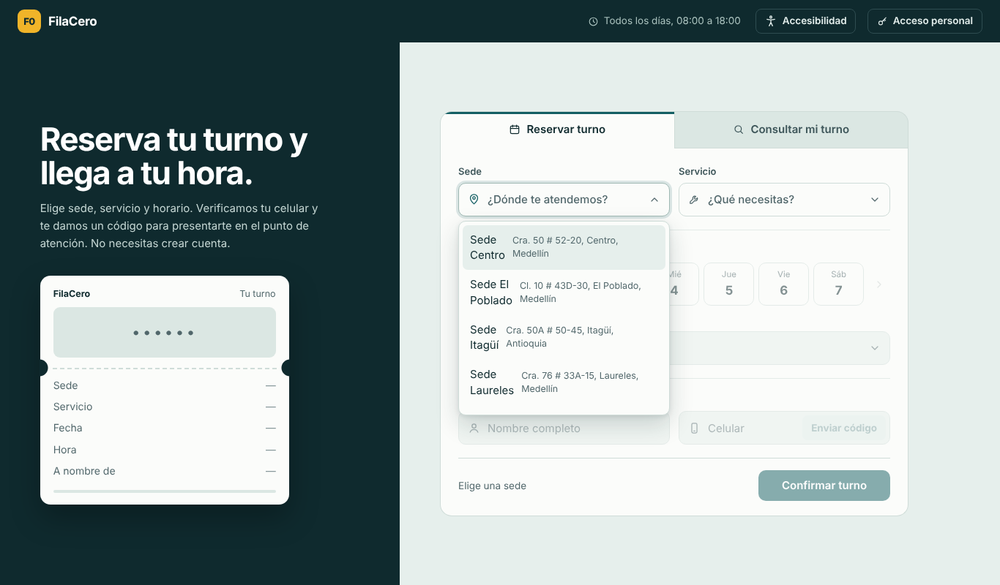
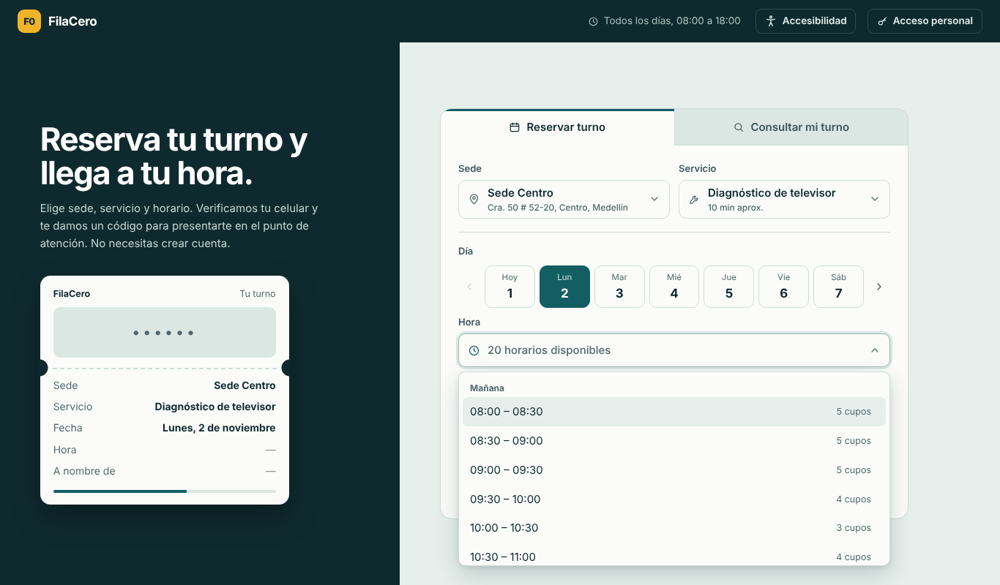

# HU-01 · Consultar la oferta de atención

| Campo | Valor |
|---|---|
| **ID** | HU-01 |
| **Rol** | Ciudadano (sin cuenta) |
| **Sprints** | 01 (base técnica) · 03 (modelo de negocio) |
| **Prioridad** | Must have |
| **Estimación** | 5 puntos |
| **Estado** | ✅ Terminada |

## Historia de usuario

> **Como** ciudadano que necesita llevar su televisor a reparar,
> **quiero** ver qué sedes y servicios hay y qué horarios quedan libres,
> **para** elegir dónde y cuándo ir sin tener que llamar ni hacer fila.

## Valor para el negocio

Esta historia es la puerta de entrada al sistema. Si el ciudadano no ve la oferta con claridad, no reserva y vuelve a la fila presencial, que es justo el problema que FilaCero resuelve.

## Criterios de aceptación

| # | Dado | Cuando | Entonces | Estado |
|---|---|---|---|---|
| CA-1 | que el ciudadano abre el portal | carga la página | ve el horario "Todos los días, 08:00 a 18:00" | ✅ |
| CA-2 | que hay sedes activas | abre el desplegable de sede | ve el nombre y la dirección de cada sede activa; las inactivas no aparecen | ✅ |
| CA-3 | que eligió sede y servicio | elige un día | ve franjas de **30 minutos** entre 8:00 y 18:00, cada una con sus cupos libres, **sin tener que pulsar un botón** | ✅ |
| CA-4 | que es hoy | consulta | no se muestran franjas que ya empezaron | ✅ |
| CA-5 | que elige una fecha pasada o a más de 30 días | consulta | la API la rechaza con un mensaje claro | ✅ |
| CA-6 | que no quedan cupos ese día | consulta | ve "No quedan horarios ese día. Prueba con otra fecha." | ✅ |

## Tareas realizadas

**Backend**
- [x] Estructura del proyecto: `crear_app()`, `config.py` desde `.env`, Blueprints por dominio y conexión a MySQL (sprint 01).
- [x] Modelos `Punto` (sede), `Tramite`, `Franja` y `Turno`, con sus migraciones Alembic (sprint 03).
- [x] `GET /api/v1/sedes/` y `GET /api/v1/tramites/` (solo activos; `?todos=1` para el panel).
- [x] `GET /api/v1/horario`: horario, días de atención y reglas de cupo.
- [x] `horario.asegurar_franjas`: genera de forma automática las franjas de 30 minutos entre 8 y 18 h, todos los días.
- [x] `GET /api/v1/franjas/disponibles?sede_id&tramite_id&fecha` con validación de la fecha (`validar_fecha_reservable`).

**Frontend**
- [x] Portal en una sola pantalla: desplegables de sede, servicio y hora; selector de días en tarjetas.
- [x] Las horas se cargan automáticamente al elegir sede, servicio y día, agrupadas en mañana y tarde, con sus cupos.
- [x] Ficha lateral que va mostrando la reserva mientras se arma.

## Diseño técnico

| Capa | Archivo |
|---|---|
| Rutas | `backend/app/dominios/sedes/controladores.py`, `tramites/controladores.py`, `franjas/disponibilidad.py` |
| Reglas | `backend/app/horario.py` (`asegurar_franjas`, `validar_fecha_reservable`, `capacidad_sede`) |
| API cliente | `frontend-react/src/api/publico.api.js` (`listarSedes`, `listarTramites`, `franjasDisponibles`, `obtenerHorario`) |
| Interfaz | `frontend-react/src/components/cliente/ReservarTurno.jsx`, `components/ui/Dropdown.jsx` |

**Regla:** la disponibilidad se calcula **por sede** (ver HU-04): `disponibles = capacidad de la sede − turnos activos en la franja`.

## Decisiones de arquitectura

- **ADR-0001 · Monolito modular:** un solo desplegable, organizado por dominios (`sedes`, `tramites`, `franjas`...).
- **ADR-0002 · Cupo por sede:** la disponibilidad que ve el ciudadano usa la misma función que valida la reserva.

## Evidencia

**Pruebas automáticas** (`python -m pytest -v`)
- `test_seguridad_y_publico.py::test_franjas_automaticas_todos_los_dias_8_a_18`
- `test_seguridad_y_publico.py::test_no_permite_fechas_pasadas_ni_muy_lejanas`
- `test_seguridad_y_publico.py::test_endpoint_horario_publico`
- `test_franjas_turnos.py::test_consultar_franjas_disponibles`
- `test_franjas_turnos.py::test_rechaza_franja_que_ya_comenzo`
- `test_despacho.py::test_disponibilidad_refleja_cupo_de_la_sede`

**Simulación** (`python simulacion.py`)
```
1. CIUDADANO — reserva sin cuenta
  ✓ Consulta el horario de atención      08:00–18:00, todos los días=True
  ✓ Carga sedes y trámites               5 sedes, 5 trámites
  ✓ Ve franjas para mañana (generadas automáticamente)   20 franjas, primera 08:00
```

**Postman:** carpeta *02 · Portal del ciudadano*: listar sedes, listar trámites y franjas disponibles.

**Capturas**

| Desplegable de sedes | Franjas de 30 min con sus cupos |
|---|---|
|  |  |

## Evolución durante el proyecto

| Versión | Qué pasaba | Qué se cambió |
|---|---|---|
| Sprint 03 | Las franjas se creaban a mano y solo de lunes a viernes | Generación automática todos los días de 8 a 18 (`FRANJAS_AUTOMATICAS`) |
| Sprint 05 | La disponibilidad era una lista larga con mucho scroll y un botón "Consultar" | Desplegables dinámicos sin botón, agrupados por jornada |
| Sprint 09 | La disponibilidad se contaba por trámite | Se cuenta **por sede** (HU-04) |

## Cómo demostrarlo en la sustentación

1. Abrir `http://localhost:5173/`.
2. Desplegar **Sede**: aparecen las 5 sedes de TecniVisión con su dirección.
3. Elegir un servicio y el día de mañana: las horas aparecen solas, cada una con sus cupos.
4. Desplegar **Hora**: se ven las franjas de 30 minutos agrupadas en mañana y tarde.
