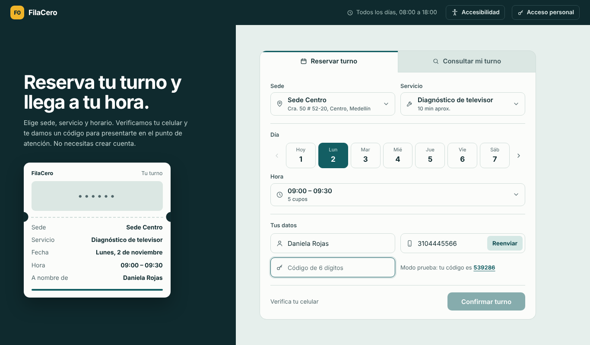
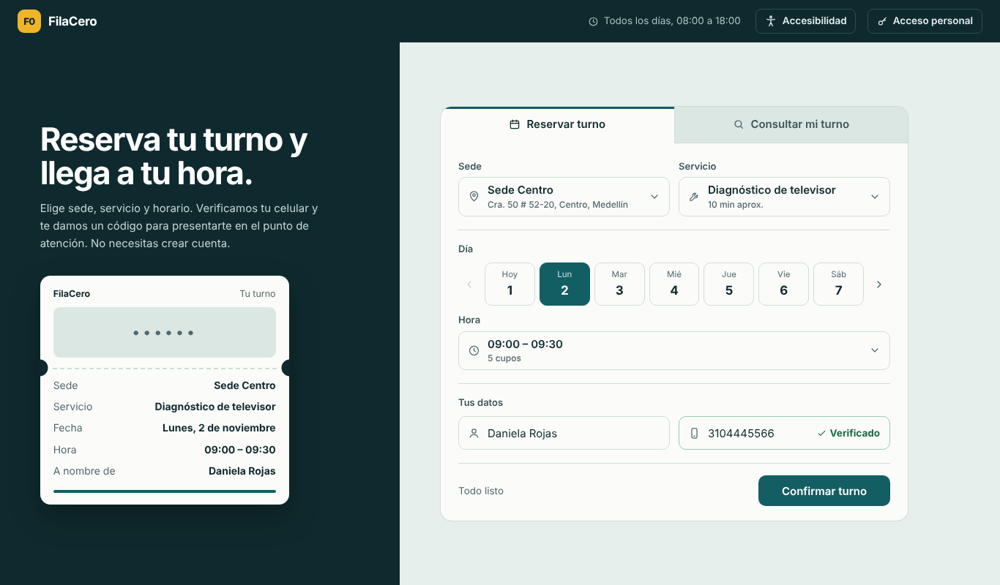
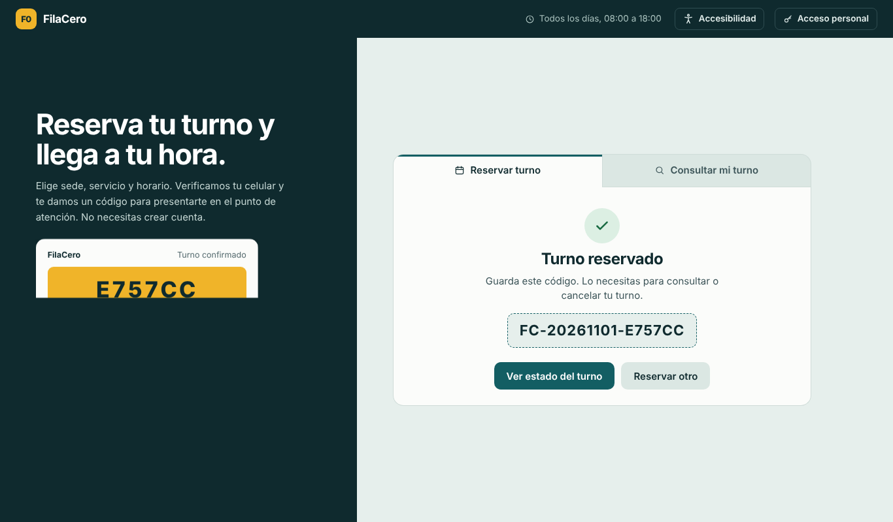

# HU-02 · Reservar un turno sin crear cuenta

| Campo | Valor |
|---|---|
| **ID** | HU-02 |
| **Rol** | Ciudadano (sin cuenta) |
| **Sprint** | 05 (portal del ciudadano) |
| **Prioridad** | Must have |
| **Estimación** | 8 puntos |
| **Estado** | ✅ Terminada |

## Historia de usuario

> **Como** ciudadano,
> **quiero** reservar mi turno solo con mi nombre y mi celular, sin registrarme,
> **para** asegurar mi cita en pocos segundos y recibir un código que me identifique en la sede.

## Valor para el negocio

Pedir cuenta y contraseña hace que mucha gente abandone la reserva. Verificar el celular con un código mantiene la seguridad: nadie reserva a nombre de un número que no controla, y es difícil llenar la agenda con reservas falsas.

## Criterios de aceptación

| # | Dado | Cuando | Entonces | Estado |
|---|---|---|---|---|
| CA-1 | un celular que no tiene 10 dígitos o no empieza por 3 | pide el código | ve "Escribe un celular de 10 dígitos que empiece por 3." | ✅ |
| CA-2 | un celular válido | pide el código | recibe un código de **6 dígitos** que vence en **5 minutos** (en desarrollo se muestra en pantalla) | ✅ |
| CA-3 | un código errado | lo escribe | ve "Código incorrecto. Te quedan N intento(s)"; tras **5 intentos** se invalida | ✅ |
| CA-4 | el código correcto | lo escribe | el celular queda "Verificado" sin pulsar otro botón | ✅ |
| CA-5 | que la reserva está completa y verificada | pulsa **Confirmar turno** | recibe un código `FC-AAAAMMDD-XXXXXX` y su ficha (sede, servicio, fecha, hora) | ✅ |
| CA-6 | que intenta reservar con un `token_verificacion` de **otro** celular | envía la reserva | la API la rechaza | ✅ |
| CA-7 | que ya tiene **3 turnos activos** | intenta otro | ve "Ya tienes 3 turnos activos…" | ✅ |
| CA-8 | que no hay proveedor de SMS en producción | se pide el código | el código nunca se revela en la respuesta | ✅ |

## Tareas realizadas

**Backend**
- [x] `turnos/otp.py`: genera el código, controla la vigencia (`OTP_VIGENCIA_SEG = 300`), los intentos (`OTP_MAX_INTENTOS = 5`) y el modo de prueba.
- [x] `POST /turnos/publico/solicitar-codigo` y `POST /turnos/publico/verificar-codigo`; esta última entrega un `token_verificacion` firmado con `itsdangerous`.
- [x] `POST /turnos/publico`: valida el token, crea o reutiliza al ciudadano por celular (`registrar_cliente_publico`) y crea el turno.
- [x] Límite de 3 turnos activos por ciudadano (`MAX_TURNOS_ACTIVOS_POR_CLIENTE`).
- [x] Límite de peticiones por IP en las rutas públicas (`LIMITE_OTP_POR_MINUTO`).

**Frontend**
- [x] Formulario en un solo paso: nombre, celular y verificación en línea; el código se valida automáticamente al completar los 6 dígitos.
- [x] Pantalla "Turno reservado" con el código grande y los botones "Ver estado del turno" y "Reservar otro".

## Diseño técnico

```
Ciudadano ─► solicitar-codigo ─► otp.py (código 6 dígitos, 5 min, 5 intentos)
          ─► verificar-codigo ─► token_verificacion firmado (vence)
          ─► POST /turnos/publico {nombre, celular, token, sede, trámite, franja}
                 └─► servicios.crear_turno (candado por sede, ver HU-04) ─► 201 turno
```

| Capa | Archivo |
|---|---|
| Rutas | `backend/app/dominios/turnos/controladores.py` |
| Reglas | `backend/app/dominios/turnos/otp.py`, `turnos/servicios.py`, `usuarios/servicios.py::registrar_cliente_publico` |
| API cliente | `frontend-react/src/api/publico.api.js` (`solicitarCodigo`, `verificarCodigo`, `reservarTurno`) |
| Interfaz | `frontend-react/src/components/cliente/ReservarTurno.jsx`, `pages/PortalPage.jsx` |

## Decisiones de arquitectura

- **ADR-0008 · Reserva sin cuenta con OTP:** se descartó el registro obligatorio, porque crea fricción, y la reserva anónima, porque permite abusos.
- **Integración crítica:** el proveedor de SMS queda aislado en `otp.py`. El escenario "proveedor lento" está analizado en `docs/arquitectura/09-evolucion.md`.

## Evidencia

**Pruebas automáticas**
- `test_seguridad_y_publico.py::test_otp_valida_formato_de_celular`
- `test_seguridad_y_publico.py::test_otp_rechaza_codigo_incorrecto_y_limita_intentos`
- `test_seguridad_y_publico.py::test_otp_sin_modo_prueba_no_revela_codigo`
- `test_seguridad_y_publico.py::test_reserva_publica_exige_verificacion_del_mismo_celular`
- `test_seguridad_y_publico.py::test_limite_de_turnos_activos_por_cliente`
- `test_franjas_turnos.py::test_crea_reserva_valida` · `test_reservar_turno_por_api`

**Simulación**
```
  ✓ Rechaza celular inválido
  ✓ Solicita código de verificación      código prueba 014595
  ✓ Rechaza código incorrecto
  ✓ Verifica el celular
  ✓ Reserva el turno                     FC-20261101-EC0A75 · Sede Centro · 08:00
  ✓ El celular se devuelve enmascarado   300****101
```

**Postman:** carpeta *02 · Portal del ciudadano*: solicitar código → verificar → reservar (la prueba comprueba el código **201**).

**Capturas**

| Código de verificación | Celular verificado | Turno reservado |
|---|---|---|
|  |  |  |

## Evolución durante el proyecto

| Versión | Qué pasaba | Qué se cambió |
|---|---|---|
| Sprint 03 | Para reservar había que registrarse e iniciar sesión (rol CLIENTE) | Esas rutas se conservan por compatibilidad (`/turnos/`, `/mis-turnos`) |
| Sprint 05 | Registro obligatorio = abandono | Reserva sin cuenta con OTP (ADR-0008) |
| Sprint 10 | El registro público seguía abierto | `REGISTRO_PUBLICO=false` para producción |

## Cómo demostrarlo en la sustentación

1. En el portal, completar sede, servicio, día y hora.
2. Escribir un nombre y el celular `3001234567` y pulsar **Verificar**: aparece el código de prueba.
3. Escribir un código errado (muestra cuántos intentos quedan) y luego el correcto: queda "Verificado".
4. **Confirmar turno**: aparecen el código grande y la ficha completa.
