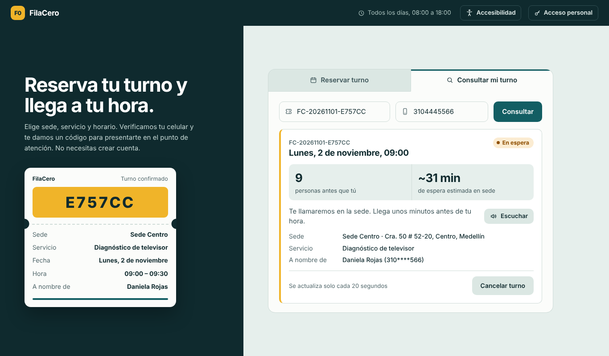
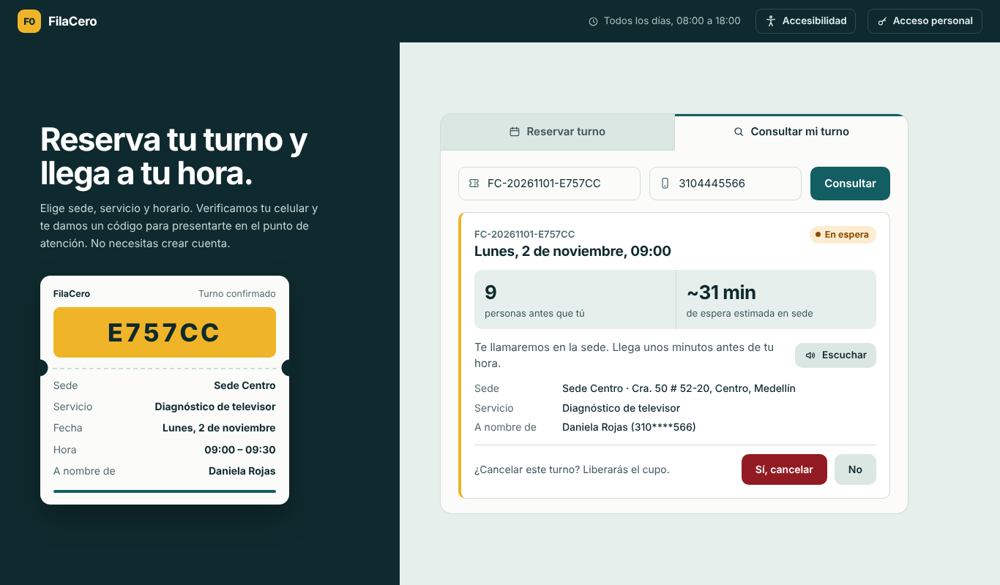

# HU-03 · Consultar y cancelar mi turno

| Campo | Valor |
|---|---|
| **ID** | HU-03 |
| **Rol** | Ciudadano (sin cuenta) |
| **Sprint** | 05 (portal del ciudadano) |
| **Prioridad** | Must have |
| **Estimación** | 5 puntos |
| **Estado** | ✅ Terminada |

## Historia de usuario

> **Como** ciudadano que ya reservó,
> **quiero** consultar el estado de mi turno y cancelarlo si no puedo ir,
> **para** saber cuánto voy a esperar y liberar el cupo para otra persona.

## Valor para el negocio

Cada cancelación libera un cupo que otra persona puede tomar, y reduce las ausencias que desordenan la agenda del asesor.

## Criterios de aceptación

| # | Dado | Cuando | Entonces | Estado |
|---|---|---|---|---|
| CA-1 | el código del turno y el celular correcto | consulta | ve el estado, la fecha, la hora, la sede, las **personas antes** y la **espera estimada** | ✅ |
| CA-2 | el código con **otro** celular | consulta o cancela | recibe 400 sin saber si el turno existe (no se filtran datos) | ✅ |
| CA-3 | un turno en espera | pulsa **Cancelar turno** y confirma | el estado pasa a "Cancelado" y el cupo queda libre | ✅ |
| CA-4 | que la consulta está abierta | pasa el tiempo | el estado se refresca solo cada 20 s, sin botón | ✅ |
| CA-5 | el resultado de la consulta | se muestra | el celular aparece enmascarado (`300****567`) | ✅ |
| CA-6 | que pulsa **Escuchar** | — | el estado se lee en voz alta | ✅ |
| CA-7 | que alguien consulta la espera de un turno ajeno (`/turnos/<id>/tiempo-espera`) | — | recibe 404 | ✅ |

## Tareas realizadas

- [x] `POST /turnos/publico/consultar`: devuelve el turno con el DTO público (`turno_publico_response`) y la espera.
- [x] `POST /turnos/publico/cancelar`: cambia el estado a CANCELADO y libera el cupo.
- [x] `turnos/prediccion.py`: calcula la espera estimada; responde 404 si el turno es de otra persona.
- [x] Pestaña "Consultar mi turno" con código y celular; tarjeta de estado con "Escuchar" y confirmación antes de cancelar.
- [x] Desde "Turno reservado", el botón **Ver estado del turno** abre la consulta ya diligenciada.

## Diseño técnico

| Capa | Archivo |
|---|---|
| Rutas | `backend/app/dominios/turnos/controladores.py` (consultar, cancelar), `turnos/prediccion.py` |
| DTO | `backend/app/dominios/turnos/dtos.py::turno_publico_response` (enmascara el celular) |
| API cliente | `frontend-react/src/api/publico.api.js` (`consultarTurno`, `cancelarTurno`) |
| Interfaz | `frontend-react/src/components/cliente/ConsultarTurno.jsx` |

**Seguridad:** el par código + celular funciona como una credencial de un solo uso. Si alguno no coincide, la respuesta es la misma, así un tercero no puede saber qué códigos existen.

## Decisiones de arquitectura

- **ADR-0008:** el ciudadano no tiene cuenta, así que se identifica con el código + el celular verificado.
- **ADR-0005 · Consulta periódica:** la tarjeta se actualiza cada 20 s con `usePolling`.

## Evidencia

**Pruebas automáticas**
- `test_seguridad_y_publico.py::test_reserva_consulta_y_cancelacion_publica`
- `test_seguridad_y_publico.py::test_cancelacion_publica_con_celular_incorrecto_responde_400`
- `test_seguridad_y_publico.py::test_espera_de_turno_ajeno_responde_404`
- `test_mejoras_entrega.py::test_consulta_y_cancelacion_publica_exigen_celular_correcto` (prueba del equipo)
- `test_mejoras_entrega.py::test_cliente_no_consulta_espera_de_turno_ajeno` (prueba del equipo)
- `test_franjas_turnos.py::test_cancelacion_libera_cupo_y_permite_reservar_de_nuevo`

**Simulación**
```
  ✓ Consulta su turno con código + celular   estado ESPERANDO, espera ~16 min
  ✓ Otro celular NO puede ver el turno
  ✓ Cancela su turno
```

**Postman:** carpeta *02*: "Consultar mi turno (código + celular)" y "Cancelar mi turno".

**Capturas**

| Estado del turno | Confirmar cancelación |
|---|---|
|  |  |

## Evolución durante el proyecto

| Versión | Qué pasaba | Qué se cambió |
|---|---|---|
| Sprint 05 | La consulta con un celular errado devolvía el turno igual | Se exige el celular correcto (400); lo detectaron las pruebas del equipo |
| Sprint 06 | La espera estimada de cualquier turno se podía consultar | 404 si el turno es ajeno |
| Sprint 11 | — | Botón **Escuchar** (lectura en voz alta) |

## Cómo demostrarlo en la sustentación

1. Después de reservar (HU-02), pulsar **Ver estado del turno**.
2. Mostrar las personas antes, la espera estimada y el celular enmascarado; pulsar **Escuchar**.
3. Cambiar un dígito del celular y consultar: aparece el mensaje de error, sin datos.
4. Con el celular correcto, **Cancelar turno** → confirmar: el estado pasa a "Cancelado".
