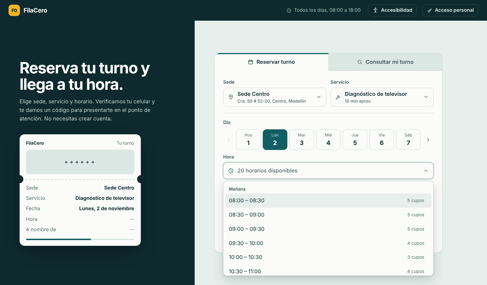
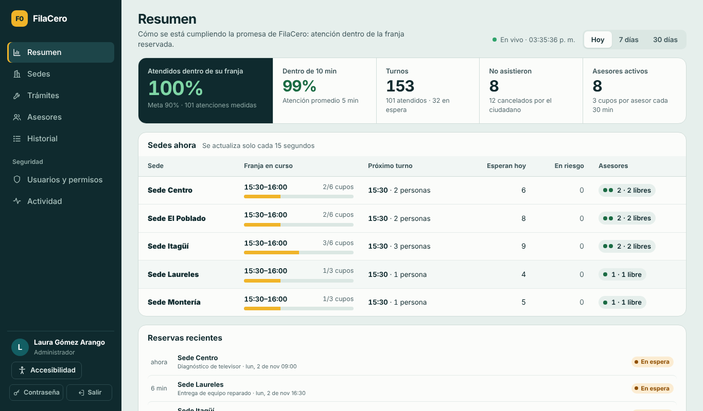

# HU-04 · Ser atendido dentro de la franja reservada

| Campo | Valor |
|---|---|
| **ID** | HU-04 |
| **Rol** | Ciudadano |
| **Sprint** | 09 (regla de puntualidad) |
| **Prioridad** | Must have: es la **promesa central** de FilaCero |
| **Estimación** | 13 puntos |
| **Estado** | ✅ Terminada |

## Historia de usuario

> **Como** ciudadano que reservó de 4:00 a 4:30 p. m.,
> **quiero** que me atiendan dentro de ese intervalo, sí o sí,
> **para** no perder la tarde esperando en la sede.

## Regla de negocio

| Parámetro | Valor | Configuración |
|---|---|---|
| Duración de la franja | 30 min | `DURACION_FRANJA_MIN=30` |
| Atención máxima | 10 min | `DURACION_MAX_ATENCION_MIN=10` |
| Cupos por asesor y franja | 30 ÷ 10 = **3** | `CUPOS_POR_ASESOR_FRANJA=0` (0 = calcular; se puede poner 4) |
| **Cupo de la sede** | **3 × asesores activos de la sede**, sumando todos los trámites | `horario.capacidad_sede` |

Ejemplo: la Sede Centro tiene 2 asesores, así que admite 6 personas por franja. La 7.ª reserva se rechaza aunque elija otro trámite.

## Criterios de aceptación

| # | Dado | Cuando | Entonces | Estado |
|---|---|---|---|---|
| CA-1 | una sede con 1 asesor | se reservan 3 turnos de trámites distintos en la misma franja | el 4.º se rechaza ("sin cupo") | ✅ |
| CA-2 | una sede con 2 asesores | se consulta la disponibilidad | la capacidad de la franja es 6 | ✅ |
| CA-3 | muchas reservas simultáneas sobre la misma franja (15 hilos con 3 cupos en la prueba; 18 peticiones HTTP con 6 cupos en la prueba de carga) | llegan al mismo tiempo | se aceptan **exactamente** los cupos (3 y 6) y el resto se rechaza: cero sobrecupo | ✅ |
| CA-4 | que se desactiva un asesor | se consulta la disponibilidad | el cupo de la sede baja de inmediato | ✅ |
| CA-5 | la operación de una semana | se mide | el indicador "Atendidos dentro de su franja" es ≥ 90 % (meta) | ✅ 99,8 % simulado |
| CA-6 | una cancelación | ocurre | el cupo se libera para otra persona | ✅ |

## Tareas realizadas

- [x] `horario.py`: `cupos_por_asesor`, `asesores_activos`, `capacidad_sede`, `ocupacion_sede` (una sola fuente de la regla).
- [x] La disponibilidad y la reserva usan **las mismas** funciones (si la regla cambia, cambia en ambas).
- [x] Control de concurrencia en `turnos/servicios.py::crear_turno`: candado por sede (`threading.Lock`) + `SELECT … FOR UPDATE` sobre la sede en MySQL; dentro de la transacción se vuelve a contar y solo entonces se inserta.
- [x] Indicador de puntualidad en el panel (HU-08) y en la consola (HU-05).
- [x] Prueba de carga y de sobrecupo en `simulacion.py --carga`.

## Decisiones de arquitectura

- **ADR-0002 · Cupo por sede y franja:** se descartaron el cupo por trámite (sobrevendía) y la fila FIFO sin cupo (no garantiza la hora).
- **ADR-0004 · Concurrencia de reservas:** candado por sede + bloqueo de fila; se descartaron el control optimista (más reintentos) y una cola asíncrona (el ciudadano no recibe el código al instante).
- **Riesgo R2:** un asesor ausente sin desactivar deja la sede sobreagendada; se mitiga con el indicador "En riesgo" del panel.

## Evidencia

**Pruebas automáticas**
- `test_despacho.py::test_un_asesor_atiende_maximo_3_por_franja_sumando_tramites`
- `test_despacho.py::test_dos_asesores_duplican_el_cupo`
- `test_despacho.py::test_disponibilidad_refleja_cupo_de_la_sede`
- `test_despacho.py::test_indicador_de_puntualidad`
- `test_reservas_concurrentes.py::test_reservas_simultaneas_respetan_el_cupo` (15 hilos a la vez, 3 cupos → 3 turnos)
- `test_franjas_turnos.py::test_no_supera_capacidad` · `test_no_permite_reservar_dos_veces_la_misma_franja`

**Prueba de carga** (`python simulacion.py --carga --url http://127.0.0.1:5000`)

| Medición | Resultado |
|---|---|
| 18 reservas simultáneas a una franja con 6 cupos | **6 aceptadas, 12 rechazadas** |
| 40 usuarios durante 20 s | 138,9 pet./s; p95 entre 127 y 273 ms; 0 errores |

**Capturas**

| Franjas con cupos por sede | Panel: "Sedes ahora", ocupación de la franja en curso |
|---|---|
|  |  |

## Evolución durante el proyecto (hallazgo real)

| Versión | Qué pasaba | Qué se cambió |
|---|---|---|
| Sprint 03 | Cupo por **trámite**: una sede con 4 servicios y 1 asesor aceptaba 12 personas por media hora | Cupo **por sede** (ADR-0002) |
| Sprint 09 | Se verificaba el cupo y luego se insertaba: la prueba de carga aceptó **7 reservas con 6 cupos** | Candado por sede + `FOR UPDATE` y una prueba de concurrencia nueva (ADR-0004) |

## Cómo demostrarlo en la sustentación

1. Explicar la regla con el ejemplo: 2 asesores × 3 = 6 cupos por franja.
2. En el portal, mostrar que cada hora indica sus cupos libres.
3. Correr `python -m pytest tests/test_reservas_concurrentes.py -v`: 15 reservas simultáneas, solo 3 aceptadas (1 asesor × 3).
4. En el panel, mostrar "Atendidos dentro de su franja".
