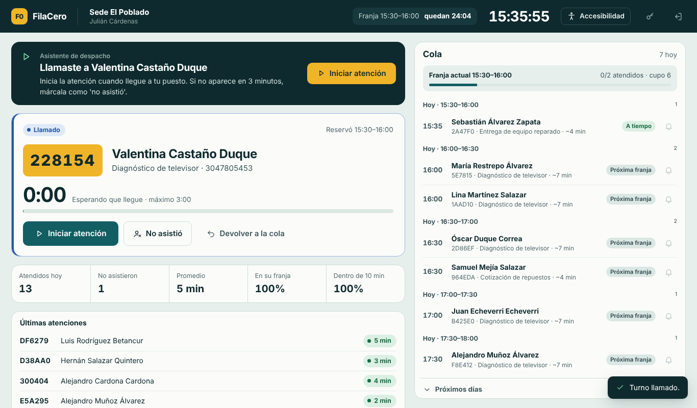
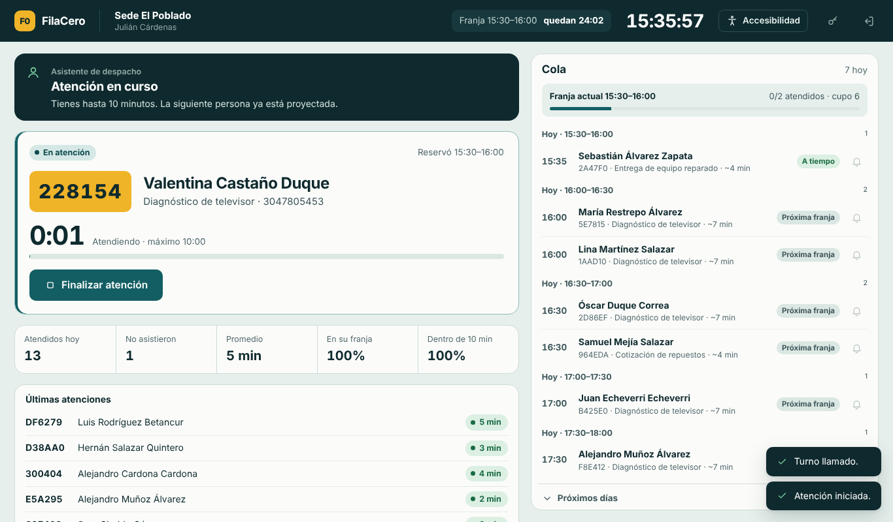

# HU-05 · Consola de atención del asesor

| Campo | Valor |
|---|---|
| **ID** | HU-05 |
| **Rol** | Asesor (`AGENTE`) |
| **Sprint** | 06 (asesores y ciclo de atención) |
| **Prioridad** | Must have |
| **Estimación** | 8 puntos |
| **Estado** | ✅ Terminada |

## Historia de usuario

> **Como** asesor de una sede,
> **quiero** ver mi cola del día y llamar, iniciar y finalizar cada atención desde una sola pantalla,
> **para** atender en orden y sin papeles, sabiendo siempre la hora y cuánto queda de la franja.

## Ciclo de un turno

```
ESPERANDO ──llamar──► LLAMADO ──iniciar──► EN_ATENCION ──finalizar──► ATENDIDO
    ▲                    │
    └──── devolver ──────┤
                         └──no asistió──► NO_ASISTIO
(el ciudadano puede pasar a CANCELADO mientras espera)
```

## Criterios de aceptación

| # | Dado | Cuando | Entonces | Estado |
|---|---|---|---|---|
| CA-1 | un asesor con sede asignada | abre `/agente` | ve el reloj, la franja actual con su cupo, la cola de **hoy** ordenada por franja y sus indicadores del día | ✅ |
| CA-2 | turnos en espera | pulsa **Llamar siguiente** | se llama al de la franja más próxima a vencer | ✅ |
| CA-3 | un turno LLAMADO | pulsa **Iniciar atención** | arranca el cronómetro (máximo 10:00) | ✅ |
| CA-4 | un turno en curso | intenta llamar a otro | ve "Ya tienes un turno en curso (…)" (400) | ✅ |
| CA-5 | un turno que no está en LLAMADO | intenta iniciarlo, o finalizar uno sin iniciar | la API lo impide | ✅ |
| CA-6 | un turno de **otra sede** | intenta atenderlo | la API lo impide | ✅ |
| CA-7 | que la persona no llega | pulsa **No asistió** o **Devolver a la cola** | el estado cambia y la cola se recalcula | ✅ |
| CA-8 | que llega una reserva nueva | — | aparece un aviso "Turno nuevo…" sin recargar (la consola consulta cada 5 s) | ✅ |
| CA-9 | `RESTRINGIR_ATENCION_HORARIO=true` | se intenta atender fuera de 8–18 | la API lo rechaza | ✅ |
| CA-10 | un ciudadano o administrador | entra a la consola | 403 / sin acceso | ✅ |

## Tareas realizadas

**Backend**
- [x] `agentes/servicios.py`: transiciones de estado validadas, un solo turno abierto por asesor, solo turnos de su sede.
- [x] Rutas `/agente/panel`, `/cola`, `/actual`, `/llamar-siguiente`, `/turnos/<id>/{llamar,iniciar,finalizar,no-asistio,devolver}`.
- [x] `fecha_llamado` en el turno (migración `b7d3e5f1a2c4`) para medir la espera y las ausencias.
- [x] `COLA_SOLO_HOY` para que el asesor vea solo la jornada.

**Frontend**
- [x] `pages/AgentePage.jsx`: barra con la sede, la franja, el tiempo restante y el reloj; tarjeta del turno actual con cronómetro; cola agrupada por franja; últimas atenciones; indicadores.
- [x] `api/agente.api.js`: una función por acción (`llamar`, `iniciar`, `finalizar`, `noAsistio`, `devolver`).
- [x] Sin botón de actualizar: `usePolling` cada 5 s; avisos con `anunciar()` para lectores de pantalla.

## Decisiones de arquitectura

- **ADR-0005 · Consulta periódica** en lugar de WebSockets: es suficiente con 8 consolas (≈ 1,6 pet./s) y es más simple de operar.
- La lógica de estados vive en el **servicio**, no en la pantalla: los botones solo reflejan lo que la API permite.

## Evidencia

**Pruebas automáticas**
- `test_franjas_turnos.py::test_agente_completa_ciclo_de_atencion`
- `test_franjas_turnos.py::test_agente_no_puede_atender_turno_de_otra_sede`
- `test_franjas_turnos.py::test_agente_no_puede_iniciar_turno_sin_llamarlo` · `test_agente_no_puede_finalizar_turno_sin_iniciarlo`
- `test_franjas_turnos.py::test_agente_no_puede_llamar_dos_veces_el_mismo_turno` · `test_agente_no_puede_llamar_si_no_hay_turnos`
- `test_seguridad_y_publico.py::test_agente_no_llama_otro_con_turno_abierto_y_marca_no_asistio`
- `test_seguridad_y_publico.py::test_agente_devuelve_turno_a_la_cola`
- `test_seguridad_y_publico.py::test_agente_no_atiende_fuera_de_horario_si_esta_restringido`
- `test_mejoras_entrega.py::test_cola_se_ordena_por_hora_de_franja` · `test_agente_no_llama_otro_turno_con_uno_en_curso` (pruebas del equipo)

**Simulación**
```
2. AGENTE — consola de atención
  ✓ Inicia sesión                        carlos.mejia@filacero.co
  ✓ Abre su panel                        sede Sede Centro, en espera 42, en horario=True
  ✓ Llama al siguiente turno             FC-20261029-8D8435 · María Betancur Martínez
  ✓ No puede llamar otro con uno abierto
  ✓ Inicia la atención
  ✓ Finaliza la atención
  ✓ Marca un turno como 'no asistió'
  ✓ El agente NO puede ver métricas de admin
```

**Postman:** carpeta *04 · Consola del asesor* (ciclo completo y 403 al entrar a admin).

**Capturas**

| Turno llamado (esperando que llegue) | Atención en curso con cronómetro |
|---|---|
|  |  |

## Evolución durante el proyecto

| Versión | Qué pasaba | Qué se cambió |
|---|---|---|
| Sprint 06 | La cola se ordenaba por la hora en que se **pidió** el turno | Orden por franja; luego EDF (HU-06) |
| Sprint 06 | Un asesor podía tener dos turnos abiertos | Un solo turno en curso (prueba del equipo) |
| Sprint 07 | La cola mezclaba turnos de otros días | `COLA_SOLO_HOY` + sección "Próximos días" plegada |
| Sprint 09 | La pantalla no mostraba la hora | Reloj, franja actual y tiempo restante en la barra |

## Cómo demostrarlo en la sustentación

1. Entrar como asesor: queda en `/agente`.
2. **Llamar siguiente** → **Iniciar atención** (corre el cronómetro) → **Finalizar atención**.
3. En otra pestaña, reservar desde el portal: aparece el aviso de turno nuevo.
4. Intentar abrir `/admin`: página 403 (ver HU-09).
