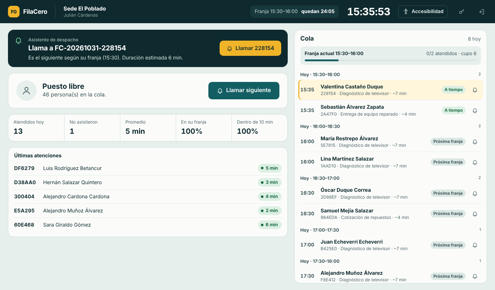

# HU-06 · Asistente de despacho para el asesor

| Campo | Valor |
|---|---|
| **ID** | HU-06 |
| **Rol** | Asesor (`AGENTE`) |
| **Sprint** | 09 (regla de puntualidad) |
| **Prioridad** | Should have |
| **Estimación** | 13 puntos |
| **Estado** | ✅ Terminada |

## Historia de usuario

> **Como** asesor,
> **quiero** que el sistema me diga a quién llamar, cuándo puedo tomar una pausa corta y cuándo me estoy demorando,
> **para** cumplir la franja de cada persona sin tener que calcularlo yo.

## Qué hace el asistente

| Situación | Recomendación |
|---|---|
| Hay turnos de la franja actual | **Llamar** al de plazo más cercano (EDF: *Earliest Deadline First*) |
| La franja está por vencer y quedan personas | **Llamar urgente** |
| Terminé rápido y la franja ya está cubierta | **Pausa activa** (por defecto 90 s; se ajusta al margen disponible) y luego llamar |
| No quedan turnos de la franja actual | **Adelantar** a alguien de la siguiente, si ya está en la sede |
| Llamé y la persona no llega en **3 min** | Sugerir **No asistió** |
| La atención pasa de **8 min** | Alerta amarilla; a los **10 min**, alerta roja de **finalizar** |
| Cada turno de la cola | Proyección: "A tiempo", "En riesgo" o "Próxima franja" |

La duración de cada atención se **estima con una regresión lineal** sobre el historial del trámite. Si no hay datos, se usa el tiempo configurado del trámite.

## Criterios de aceptación

| # | Dado | Cuando | Entonces | Estado |
|---|---|---|---|---|
| CA-1 | turnos de distintas franjas | se abre el panel | la cola y la recomendación siguen el orden EDF | ✅ |
| CA-2 | un asesor adelantado | se abre el panel | se recomienda una pausa activa con un botón de cuenta regresiva | ✅ |
| CA-3 | una franja a punto de vencer | — | la recomendación es "llamar" con prioridad urgente | ✅ |
| CA-4 | ningún turno en la franja actual | — | se sugiere adelantar a alguien de la siguiente | ✅ |
| CA-5 | un llamado sin respuesta en 3 min | — | se sugiere marcar "no asistió" | ✅ |
| CA-6 | una atención de más de 10 min | — | alerta para finalizar | ✅ |
| CA-7 | la jornada | se mide | el panel muestra "En su franja" y "Dentro de 10 min" | ✅ |

## Tareas realizadas

- [x] `agentes/despacho.py`: orden EDF, estimación por regresión lineal, proyección por turno y motor de recomendaciones.
- [x] Integración con `/agente/panel` (recomendación, `franja_actual`, proyección de la cola).
- [x] Interfaz: banner del asistente con una acción principal, chips de proyección por turno, pausa con cuenta regresiva y alertas de color en el cronómetro.
- [x] Configuración: `PAUSA_ACTIVA_SEG`, `DURACION_MAX_ATENCION_MIN`.

## Decisiones de arquitectura

- **ADR-0003 · Asistente de despacho EDF:** se descartaron la fila FIFO por hora de solicitud (no protege la franja) y un modelo de *machine learning* (no hay datos suficientes y es difícil de explicar). La regresión lineal es explicable y basta.
- **Trade-off:** la proyección se calcula en cada consulta (más CPU), a cambio de no mantener estado en caché. Medido: p95 < 300 ms.

## Evidencia

**Pruebas automáticas** (`tests/test_despacho.py`)
- `test_recomienda_pausa_activa_si_va_adelantado`
- `test_recomienda_llamar_urgente_si_la_franja_se_vence`
- `test_sugiere_adelantar_turno_de_la_siguiente_franja`
- `test_sugiere_no_asistio_si_no_llega_en_3_minutos`
- `test_alerta_cuando_la_atencion_supera_10_minutos`
- `test_indicador_de_puntualidad`
- `test_panel_y_llamado_especifico_por_api`

**Simulación**
```
  ✓ El asistente de despacho da una recomendación   llamar: Llama a FC-20261029-8D8435
  ✓ Muestra la franja actual y su cupo              15:30–16:00, 2/6 cupos, quedan 25 min
  ✓ Proyecta la puntualidad de cada turno           8D8435:a_tiempo, AFB94F:proxima, 0F5CEF:proxima
```

**Resultado de la semana simulada:** 99,8 % de los ciudadanos atendidos dentro de su franja (meta 90 %). Es un dato simulado; falta medirlo en operación real.

**Captura**



## Evolución durante el proyecto (hallazgo real)

| Versión | Qué pasaba | Qué se cambió |
|---|---|---|
| Sprint 06 | Cola por orden de solicitud: alguien que reservó para otro día pasaba antes que el de hoy | Orden por plazo de la franja (EDF) |
| Sprint 09 | El asesor que terminaba en 3 min no sabía si llamar o esperar | Pausa activa y la opción de adelantar |
| Sprint 09 | No se detectaban las atenciones largas | Alertas a los 8 y 10 min |

## Cómo demostrarlo en la sustentación

1. Entrar como asesor y leer el banner del asistente ("Llama a FC-…").
2. Señalar los chips "A tiempo" y "Próxima franja" en la cola.
3. Llamar a alguien y esperar: el banner cambia de recomendación.
4. Mostrar `tests/test_despacho.py` corriendo en verde.
