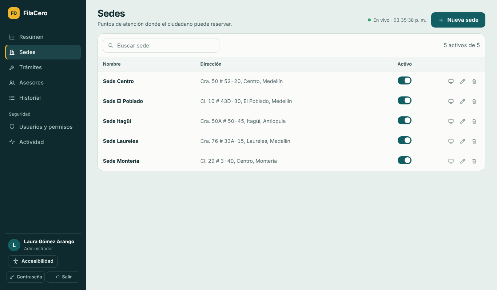
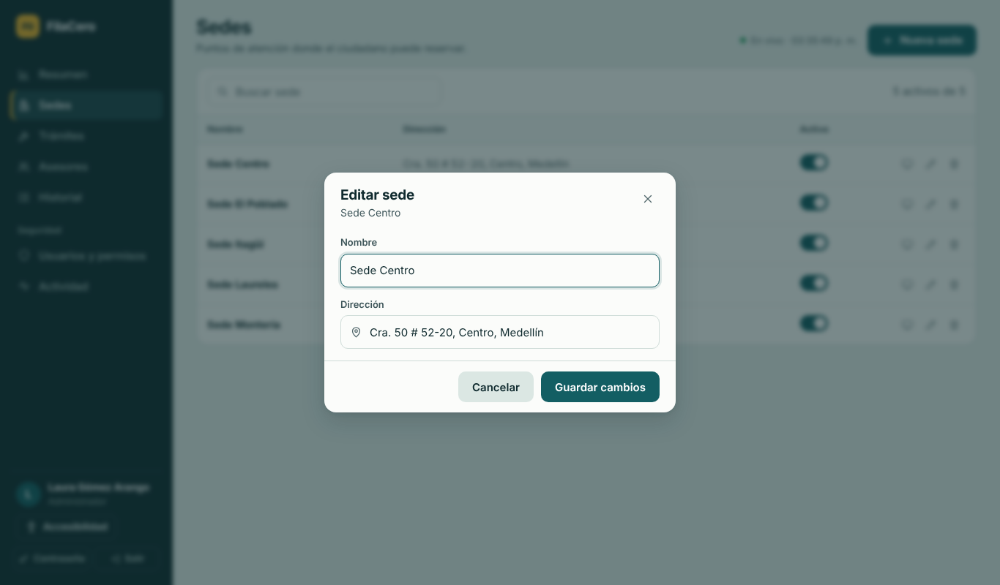
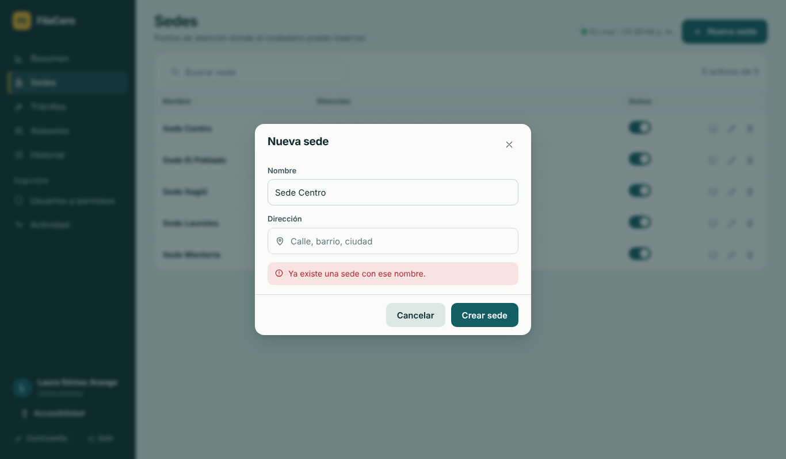
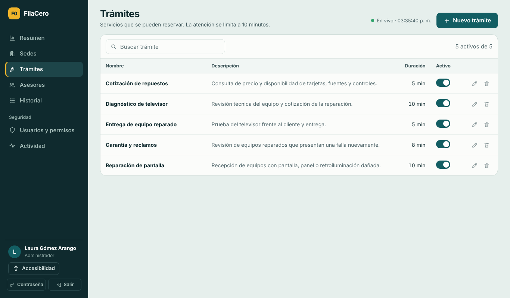
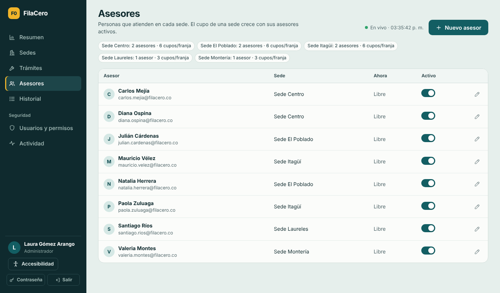

# HU-07 · Gestión de sedes, trámites y asesores

| Campo | Valor |
|---|---|
| **ID** | HU-07 |
| **Rol** | Administrador (`ADMIN`) |
| **Sprints** | 04 (administración del catálogo) · 07 (asesores) |
| **Prioridad** | Must have |
| **Estimación** | 8 puntos |
| **Estado** | ✅ Terminada |

## Historia de usuario

> **Como** administrador de TecniVisión,
> **quiero** crear, editar, activar o desactivar y eliminar sedes, servicios y asesores desde el panel,
> **para** que la oferta y la capacidad de cada sede estén siempre al día sin tocar la base de datos.

## Criterios de aceptación

| # | Dado | Cuando | Entonces | Estado |
|---|---|---|---|---|
| CA-1 | el panel | entra a Sedes, Trámites o Asesores | ve una tabla compacta con buscador y, por fila, íconos pequeños de **editar** y **eliminar** | ✅ |
| CA-2 | una fila | pulsa el ícono de lápiz | se abre una **ventana emergente** con el formulario (no se edita en la tabla) | ✅ |
| CA-3 | el interruptor "Activa" | lo cambia | se activa o desactiva al instante; una sede inactiva desaparece del portal | ✅ |
| CA-4 | un nombre que ya existe (sin importar mayúsculas) | guarda | ve "Ya existe una sede con ese nombre." · **409** | ✅ |
| CA-5 | una sede o trámite **con turnos** | intenta eliminar | ve "Desactívala en lugar de eliminarla." · **409** (no se pierde historial) | ✅ |
| CA-6 | un trámite | pone una duración fuera de 1–10 min | la interfaz lo impide (regla de atención máxima) | ✅ |
| CA-7 | un asesor | se le asigna o cambia la sede | el cupo de esa sede se recalcula (HU-04) | ✅ |
| CA-8 | un supervisor | entra a estas secciones | ve todo, pero sin botones de crear, editar ni eliminar; la API responde 403 si lo intenta | ✅ |
| CA-9 | cualquier cambio | se guarda | queda en la bitácora (HU-09) | ✅ |

## Tareas realizadas

**Backend**
- [x] CRUD `/sedes/` y `/tramites/` (`ADMIN`), con `?todos=1` para ver los inactivos.
- [x] `/admin/agentes/`: crear, editar, activar o desactivar, asignar o quitar sede.
- [x] Excepciones de dominio: `SedeDuplicadaError` / `TramiteDuplicadoError` (409), `SedeNoEncontradaError` (404), `SedeConTurnosError` (409), `DatosInvalidosError` (400).
- [x] Auditoría: `sede_creada`, `sede_editada`, `sede_eliminada`, etc.

**Frontend**
- [x] `components/admin/Catalogo.jsx` (sedes y trámites con una sola configuración), `components/admin/Agentes.jsx`.
- [x] `components/ui/Modal.jsx` (foco atrapado, Escape) y `Confirmar` para eliminar.
- [x] Interruptor `Switch` con actualización optimista y avisos (toasts).
- [x] `api/catalogo.api.js` y `api/admin.api.js`; las URL `/admin/sedes`, `/admin/tramites` y `/admin/agentes` son enlazables.

## Decisiones de arquitectura

- **ADR-0009 · Errores de dominio + manejador global:** el servicio lanza `SedeDuplicadaError` sin conocer HTTP y `app/errores.py` lo traduce a 409.
- **Desactivar en vez de borrar** cuando hay turnos: conserva el historial y las métricas.

## Evidencia

**Pruebas automáticas**
- `test_seguridad_y_publico.py::test_admin_crea_agente_y_edita_catalogo`
- `test_contrato_y_errores.py::test_sede_inexistente_responde_404_y_duplicada_409`
- `test_contrato_y_errores.py::test_datos_invalidos_responden_400`
- `test_franjas_turnos.py::test_cliente_no_puede_crear_sedes` · `test_cliente_no_puede_crear_tramites`
- `test_franjas_turnos.py::test_listar_agentes_exige_rol_admin`
- `test_usuarios_permisos.py::test_admin_crea_supervisor_con_clave_temporal_y_debe_cambiarla` (el supervisor no edita)

**Simulación**
```
3. ADMINISTRADOR — gestión y métricas
  ✓ Crea una sede                        Sede Simulada 65287
  ✓ Edita la sede
  ✓ Crea un trámite
  ✓ Rechaza trámite duplicado (409 Conflicto)
  ✓ Crea un agente y le asigna sede
  ✓ Elimina el trámite sin turnos
  ✓ Desactiva la sede de prueba
```

**Postman:** carpeta *05 · Catálogo* (incluye "Crear sede repetida → 409") y carpeta *06* (asesores).

**Capturas**

| Sedes | Editar en ventana emergente | Nombre repetido → 409 |
|---|---|---|
|  |  |  |

| Trámites | Asesores |
|---|---|
|  |  |

## Evolución durante el proyecto

| Versión | Qué pasaba | Qué se cambió |
|---|---|---|
| Sprint 04 | Formularios de edición abiertos en la misma página, con botones grandes | Íconos pequeños + ventana emergente |
| Sprint 07 | Había un botón "Actualizar" en cada sección | Actualización automática (`usePolling`) |
| Sprint 12 | Un nombre repetido y un recurso inexistente respondían 400 | 409 y 404 con excepciones de dominio (ADR-0009) |

## Cómo demostrarlo en la sustentación

1. Entrar como administrador → **Sedes**.
2. Pulsar el lápiz de una sede: se abre la ventana emergente.
3. **Nueva sede** con el nombre "Sede Centro": mensaje de 409 dentro de la ventana.
4. Apagar el interruptor de una sede y comprobar en el portal que ya no aparece.
