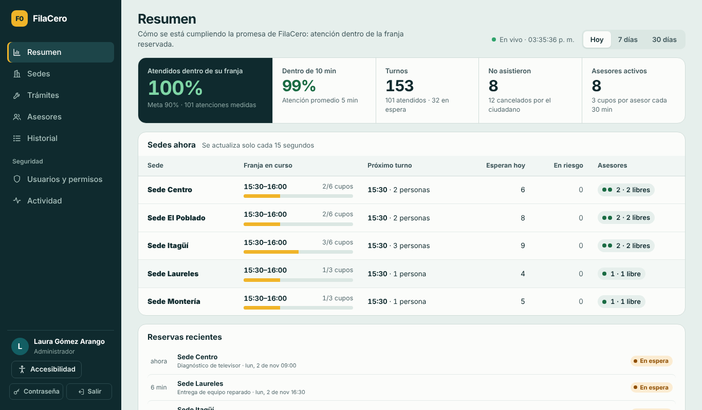
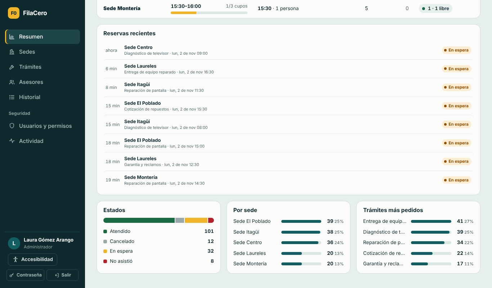
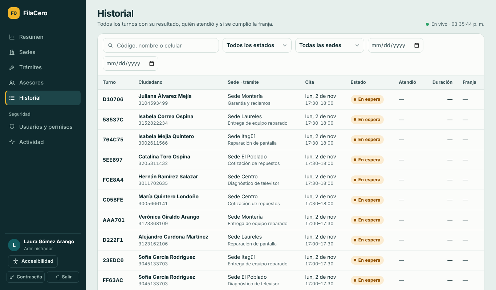

# HU-08 · Supervisión en vivo e historial

| Campo | Valor |
|---|---|
| **ID** | HU-08 |
| **Rol** | Administrador y Supervisor |
| **Sprint** | 07 (métricas, historial y panel en vivo) |
| **Prioridad** | Must have |
| **Estimación** | 8 puntos |
| **Estado** | ✅ Terminada |

## Historia de usuario

> **Como** administrador o supervisor,
> **quiero** ver en vivo cómo va cada sede y si se está cumpliendo la promesa, y consultar el historial de turnos,
> **para** reaccionar a tiempo (mover un asesor, desactivar a uno ausente) y rendir cuentas con datos.

## Criterios de aceptación

| # | Dado | Cuando | Entonces | Estado |
|---|---|---|---|---|
| CA-1 | el Resumen | se abre | muestra los indicadores **Atendidos dentro de su franja** (meta 90 %), **Dentro de 10 min**, turnos, no asistieron y asesores activos | ✅ |
| CA-2 | el Resumen | — | la tabla "Sedes ahora" muestra por sede la franja en curso con su barra de ocupación, el próximo turno, cuántos esperan hoy, cuántos están **en riesgo** y los asesores libres | ✅ |
| CA-3 | el Resumen | llega una reserva | aparece en "Reservas recientes" **sin pulsar actualizar** (cada 15 s; indicador "En vivo · hora") | ✅ |
| CA-4 | los filtros Hoy, 7 días o 30 días | cambia el periodo | se recalculan las métricas por estado, por sede y por trámite | ✅ |
| CA-5 | el Historial | filtra por estado, sede, fechas o texto | ve resultados paginados con la hora de la cita, la de atención, la duración y si se cumplió la franja | ✅ |
| CA-6 | una paginación inválida | se pide | 400 | ✅ |
| CA-7 | un asesor o un ciudadano | pide métricas | 403 | ✅ |
| CA-8 | sin conexión | ocurre | el indicador dice "Sin conexión, reintentando" y conserva los últimos datos | ✅ |

## Tareas realizadas

**Backend**
- [x] `/admin/agentes/metricas`, `/metricas/sedes`, `/metricas/tramites` con un rango `desde` / `hasta`.
- [x] `/admin/agentes/en-vivo`: ocupación por sede en la franja actual, el próximo turno y las reservas recientes.
- [x] `/admin/agentes/historial`: filtros y paginación validada.
- [x] Indicadores de puntualidad calculados en `despacho.py` (la misma fuente que la consola).

**Frontend**
- [x] `components/admin/Resumen.jsx`: tarjetas, "Sedes ahora", "Reservas recientes" y gráficas de barras por estado, sede y trámite.
- [x] `components/admin/Historial.jsx`: filtros con desplegables y búsqueda con espera corta (350 ms).
- [x] `hooks/usePolling.js` + `components/layout/Encabezado.jsx` (indicador "En vivo").
- [x] Sin botones de "actualizar página" en todo el panel.

## Decisiones de arquitectura

- **ADR-0005 · Actualización por consulta periódica:** el panel consulta cada 15 s (≈ 0,8 pet./s por panel); se descartaron WebSockets por la complejidad operativa.
- **Supervisor de solo lectura** (ADR-0007): ve todo, no modifica nada.

## Evidencia

**Pruebas automáticas**
- `test_franjas_turnos.py::test_admin_consulta_metricas_y_estadisticas`
- `test_franjas_turnos.py::test_admin_historial_paginado` · `test_historial_rechaza_paginacion_invalida`
- `test_franjas_turnos.py::test_cliente_no_puede_consultar_metricas`
- `test_seguridad_y_publico.py::test_metricas_por_sede_incluyen_nombre`
- `test_despacho.py::test_indicador_de_puntualidad`

**Simulación**
```
  ✓ Consulta métricas generales          887 turnos, 578 atendidos, promedio 5.8 min
  ✓ Métricas por sede con nombre         Sede El Poblado: 222, Sede Itagüí: 220, Sede Centro: 219
  ✓ Historial paginado con filtros       578 atendidos en 116 páginas
  ✓ El supervisor ve las métricas
```

**Postman:** carpeta *06 · Supervisión y métricas*.

**Capturas**

| Resumen en vivo | Reservas recientes y gráficas |
|---|---|
|  |  |



## Evolución durante el proyecto (hallazgo real)

| Versión | Qué pasaba | Qué se cambió |
|---|---|---|
| Sprint 07 | Botones "Actualizar" y métricas sin nombre de sede | Actualización automática; métricas con nombre |
| Sprint 09 | El equipo reportó que "los turnos no llegan": el Resumen se veía vacío ("0/0") cuando no había datos del día | "Próximo turno", barra de cupo y panel "Reservas recientes" |
| Sprint 11 | En pantallas de 1366 px, la tabla en vivo se cortaba | La rejilla pasa a una columna por debajo de 1440 px |

## Cómo demostrarlo en la sustentación

1. Con la semana simulada cargada, entrar como administrador: Resumen con "En vivo · hora".
2. Reservar desde el portal en otra pestaña: en ≤ 15 s aparece en "Reservas recientes".
3. Cambiar a **7 días**: se recalculan las gráficas.
4. Historial: filtrar por sede y estado "Atendido".
