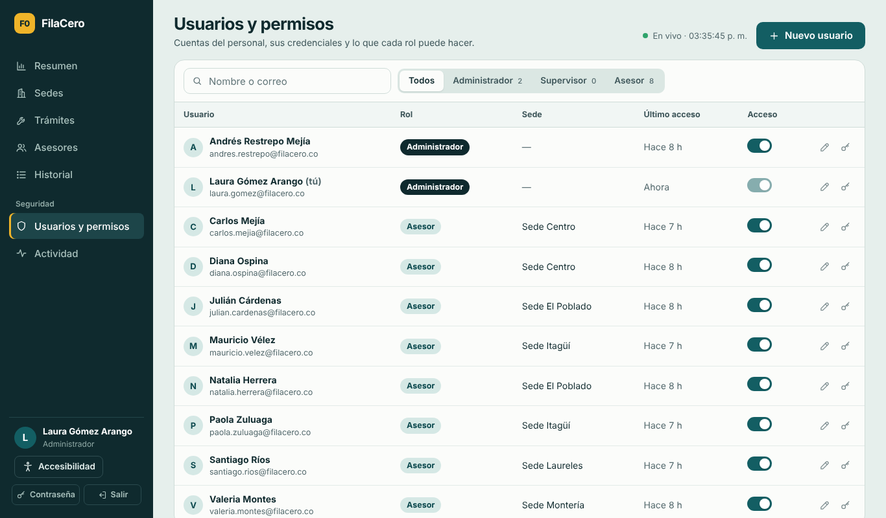
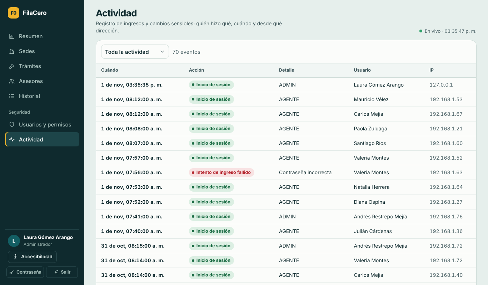
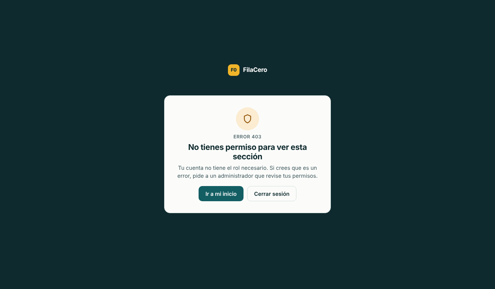

# HU-09 · Usuarios, permisos y acceso seguro

| Campo | Valor |
|---|---|
| **ID** | HU-09 |
| **Rol** | Administrador (y todo el personal al iniciar sesión) |
| **Sprints** | 02 (usuarios y JWT) · 10 (permisos, bloqueo, bitácora) · 12 (revocación inmediata y guardas de ruta) |
| **Prioridad** | Must have |
| **Estimación** | 13 puntos |
| **Estado** | ✅ Terminada |

## Historia de usuario

> **Como** administrador,
> **quiero** crear las cuentas del personal, asignarles un rol, restablecer contraseñas y ver quién hizo qué,
> **para** que cada persona solo pueda hacer lo que le corresponde y para poder auditar cualquier cambio.

## Roles

| Rol | Puede |
|---|---|
| `ADMIN` | Todo el panel, incluidas las secciones Usuarios y permisos y Actividad |
| `SUPERVISOR` | Ver todo el panel, en **solo lectura** |
| `AGENTE` | Solo la consola de atención de su sede |
| Ciudadano | Sin cuenta: reserva con su celular (HU-02) |

## Criterios de aceptación

| # | Dado | Cuando | Entonces | Estado |
|---|---|---|---|---|
| CA-1 | el administrador | crea una cuenta | el sistema genera una **clave temporal** que se muestra **una sola vez**; al entrar, la persona debe cambiarla antes de ver cualquier pantalla | ✅ |
| CA-2 | un asesor con la sesión abierta | el admin le cambia el rol o lo desactiva | pierde el acceso **en su siguiente petición** | ✅ |
| CA-3 | cualquier persona | cierra sesión o cambia su contraseña | los tokens anteriores dejan de servir **al instante**, aunque se hayan emitido en el mismo segundo | ✅ |
| CA-4 | 5 contraseñas erradas | se intenta de nuevo | la cuenta queda bloqueada 15 min (**429**); al restablecer la clave se desbloquea | ✅ |
| CA-5 | un correo que no existe o una clave errada | se intenta entrar | el mismo mensaje genérico: "Correo o contraseña incorrectos." (401) | ✅ |
| CA-6 | el administrador | intenta quitarse su propio rol o desactivarse | no se permite, y siempre debe quedar al menos un admin activo | ✅ |
| CA-7 | un token con el rol alterado | se usa | no sirve: el rol se lee de la base de datos | ✅ |
| CA-8 | un asesor | abre `/admin` | página **403** "No tienes permiso…" **sin cerrar su sesión** | ✅ |
| CA-9 | alguien sin sesión | abre `/admin/usuarios` | se le pide iniciar sesión (`/?ingresar=1`) | ✅ |
| CA-10 | cualquier acción sensible | ocurre | queda en **Actividad** con fecha, usuario, detalle e IP | ✅ |

## Tareas realizadas

**Backend**
- [x] Contraseñas con hash (Werkzeug) y política de 8+ caracteres con letras y números.
- [x] JWT de 60 min; `requiere_rol` valida el rol **actual** en la BD en cada petición.
- [x] Versión de sesión (claim `ver` + columna `version_sesion`, migración `e5a7c9d1f3b4`) para la revocación inmediata.
- [x] Bloqueo de cuenta (`MAX_INTENTOS_LOGIN=5`, `MINUTOS_BLOQUEO=15`) y límite de peticiones por IP en el login.
- [x] `/admin/usuarios/`: crear, editar rol y estado, restablecer clave; `/admin/usuarios/auditoria`.
- [x] `auditoria/`: bitácora tolerante a fallos (si no puede registrar, no detiene la operación).
- [x] `scripts/promover_admin.py` para recuperar el acceso de administrador.

**Frontend**
- [x] `components/admin/Usuarios.jsx` (filtros por rol, interruptor de acceso, restablecer con la clave visible una vez y botón de copiar) y `Actividad.jsx`.
- [x] `auth/session.service.js`, `auth/permissions.js`, `router/guards.js`: rutas por rol, páginas 403 y 404, cambio de clave obligatorio.
- [x] `api/http.js`: un 401 cierra la sesión en toda la app; un 403 no.

## Decisiones de arquitectura

- **ADR-0007 · JWT corto + rol en BD + revocación:** se descartaron las sesiones en servidor (estado compartido, CSRF) y un proveedor externo de identidad (costo).
- **ADR-0009 · Guardas de ruta como en la referencia:** ocultar botones **no** es seguridad; la decisión real la toma el backend.
- Detalle de amenazas y controles: [`SECURITY.md`](../../SECURITY.md).

## Evidencia

**Pruebas automáticas**
- `test_usuarios_permisos.py`: `test_admin_crea_supervisor_con_clave_temporal_y_debe_cambiarla`, `test_cambio_de_rol_aplica_de_inmediato`, `test_protecciones_del_administrador`, `test_editar_correo_y_restablecer_clave`, `test_cambiar_mi_clave_exige_la_actual`, `test_auditoria_registra_ingresos_y_cambios`, `test_bloqueo_tras_5_intentos_y_desbloqueo_al_restablecer`, `test_cambiar_clave_revoca_tokens_anteriores_y_entrega_uno_nuevo`, `test_logout_revoca_la_sesion`
- `test_contrato_y_errores.py`: `test_credenciales_invalidas_responden_401`, `test_cuenta_bloqueada_responde_429`, `test_asesor_no_entra_a_rutas_de_admin`, `test_sin_token_responde_401`, `test_logout_revoca_al_instante_aunque_sea_el_mismo_segundo`, `test_token_nuevo_tras_cambiar_clave_sigue_valido`
- `test_seguridad_y_publico.py`: `test_usuario_desactivado_pierde_acceso_aunque_tenga_token`, `test_token_con_rol_falsificado_no_sirve`, `test_login_con_mensaje_generico_y_cliente_publico_sin_acceso`, `test_rate_limit_de_login`, `test_cors_solo_origen_permitido_y_cabeceras_seguras`, `test_produccion_rechaza_configuracion_insegura`

**Simulación**
```
4. USUARIOS Y PERMISOS
  ✓ El admin crea un supervisor con clave temporal
  ✓ Con clave temporal no puede entrar al panel
  ✓ Cambia su contraseña y recibe una sesión nueva
  ✓ El supervisor NO puede crear sedes
  ✓ La auditoría registra lo ocurrido
5. SEGURIDAD
  ✓ Sin token → 401   ✓ Token falso → 401   ✓ Contraseña errada → mensaje genérico
  ✓ CORS bloquea orígenes no autorizados   ✓ Cabeceras de seguridad presentes
```

**Postman:** carpetas *03*, *07* y *09* (al final, el *logout* deja el token en 401 al instante).

**Capturas**

| Usuarios y permisos | Actividad (bitácora) | Asesor en `/admin` → 403 |
|---|---|---|
|  |  |  |

## Evolución durante el proyecto (hallazgos reales)

| Versión | Qué pasaba | Qué se cambió |
|---|---|---|
| Sprint 02 | El rol se leía solo del token: un asesor degradado seguía operando 60 min | Rol leído de la BD en cada petición |
| Sprint 10 | No se podía revocar una sesión | `sesiones_desde` + bloqueo de cuenta + bitácora |
| Sprint 12 | La colección Postman mostró que un token emitido **en el mismo segundo** del *logout* seguía sirviendo | Versión de sesión en el token (revocación exacta) |
| Sprint 12 | La pantalla dependía solo del rol, sin URL | Rutas con guardas, 403 que no cierra la sesión y 404 |

## Cómo demostrarlo en la sustentación

1. Administrador → **Usuarios y permisos** → **Nuevo usuario** (Supervisor): se muestra la clave temporal.
2. Entrar con esa cuenta en una ventana privada: obliga a cambiar la clave.
3. Como asesor, abrir `/admin`: página 403; "Ir a mi inicio" → `/agente`.
4. Administrador → **Actividad**: aparecen los eventos que acabamos de hacer.
