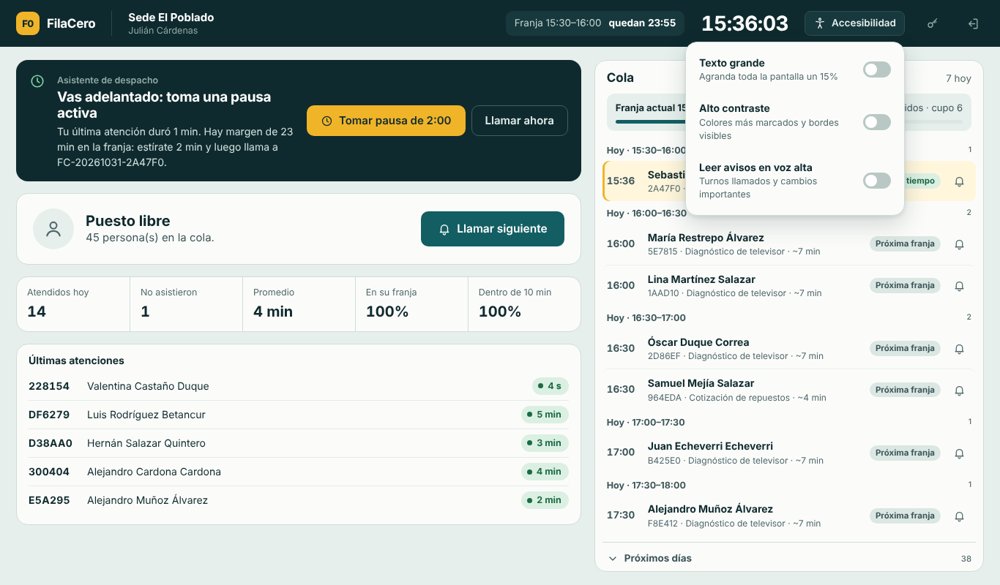
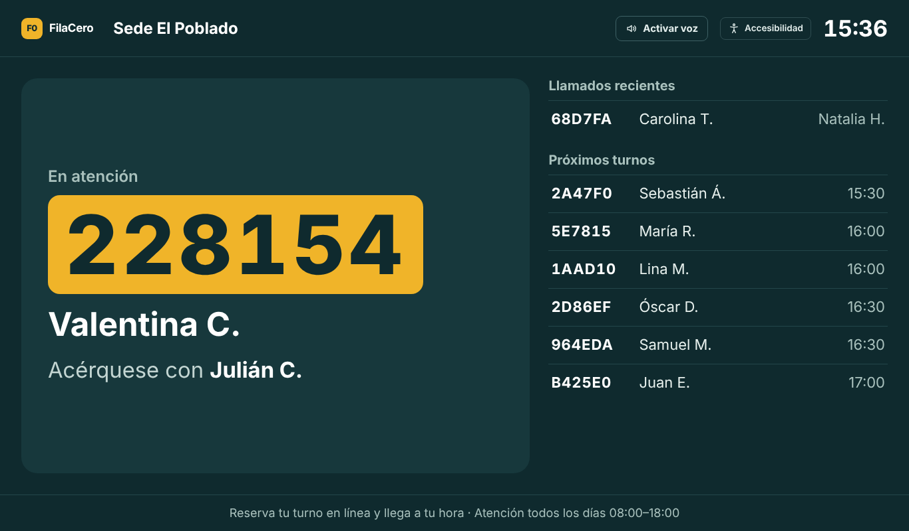

# HU-10 · Accesibilidad y pantalla de la sala de espera

| Campo | Valor |
|---|---|
| **ID** | HU-10 |
| **Rol** | Ciudadano con baja visión o que usa lector de pantalla · Ciudadano en la sala |
| **Sprint** | 11 (accesibilidad WCAG 2.2 AA y sala con voz) |
| **Prioridad** | Should have |
| **Estimación** | 8 puntos |
| **Estado** | ✅ Terminada |

## Historias de usuario

> **Como** persona con baja visión o que usa lector de pantalla,
> **quiero** agrandar el texto, aumentar el contraste, oír los avisos y manejar todo con el teclado,
> **para** reservar y consultar mi turno sin depender de otra persona.

> **Como** ciudadano que espera en la sede,
> **quiero** ver en la pantalla de la sala, y oír en voz alta, a quién llaman y a qué puesto,
> **para** no perder mi turno aunque esté distraído.

## Criterios de aceptación

| # | Dado | Cuando | Entonces | Estado |
|---|---|---|---|---|
| CA-1 | cualquier pantalla | abre el menú **Accesibilidad** | puede activar **Texto grande** (+15 %), **Alto contraste** y **Leer avisos en voz alta**; la elección se recuerda | ✅ |
| CA-2 | que navega con el teclado | pulsa Tab al cargar | el primer foco es "Saltar al contenido" | ✅ |
| CA-3 | los desplegables | se usan con el teclado | flechas, Enter y Escape funcionan (patrón *combobox* de ARIA) | ✅ |
| CA-4 | una ventana emergente | se abre | el foco queda atrapado dentro y Escape la cierra | ✅ |
| CA-5 | un aviso (turno llamado, error, guardado) | ocurre | se anuncia al lector de pantalla (`aria-live`) y, si la voz está activa, en voz alta | ✅ |
| CA-6 | todas las pantallas | se auditan con axe-core | **0 violaciones WCAG 2.2 AA** | ✅ |
| CA-7 | la TV de la sala (`/sala?sede=N`) | un asesor llama un turno | aparece en grande el código, el nombre corto y el asesor, y se anuncia: "Turno … acérquese con …" | ✅ |
| CA-8 | la pantalla de sala | se consulta la API | **no** expone nombres completos ni celulares | ✅ |
| CA-9 | la sala | pasa el tiempo | se actualiza sola cada 4 s; muestra los llamados recientes y los próximos turnos | ✅ |

## Tareas realizadas

- [x] `hooks/useAccesibilidad.js`: preferencias guardadas, `hablar()` con la Web Speech API (voz en español), `anunciar()` con una región `aria-live`, `teclasPestanas()`.
- [x] `components/ui/Accesibilidad.jsx`: menú y enlace "Saltar al contenido".
- [x] `components/ui/Dropdown.jsx` (combobox accesible) y `Modal.jsx` (foco atrapado).
- [x] Contraste: se oscureció `--tinta-3` a `#51676b`; los textos de ayuda y los encabezados quedaron en orden.
- [x] `pages/SalaPage.jsx` + `GET /turnos/publico/sala` con un DTO sin datos personales.
- [x] Botón **Escuchar** en la consulta del turno (HU-03).

## Decisiones de arquitectura

- Accesibilidad sin dependencias externas (no se usa un framework de UI), para controlar el contraste y el foco.
- La sala es una ruta **pública** del mismo SPA, de modo que cada sede solo necesita un navegador en la TV (ADR-0006).
- **Limitación aceptada:** la voz depende del navegador de cada equipo (`docs/arquitectura/07-analisis-de-atributos.md`).

## Evidencia

**Pruebas automáticas**
- `test_seguridad_y_publico.py::test_pantalla_de_sala_no_expone_datos_personales`

**Auditoría de accesibilidad:** axe-core 4.10 sobre 13 pantallas (portal, reserva, consulta, acceso, panel y sus secciones, consola, sala, 403 y 404), con **0 violaciones** WCAG 2.2 AA. La misma auditoría se repitió después de reorganizar el frontend (sprint 12).

**Capturas**

| Menú de accesibilidad | Pantalla de la sala |
|---|---|
|  |  |

## Evolución durante el proyecto

| Versión | Qué pasaba | Qué se cambió |
|---|---|---|
| Sprint 05 | axe-core encontró placeholders con bajo contraste, desplegables sin nombre y saltos en los encabezados | Corrección de los colores, `ariaLabel` y orden h1 → h2 |
| Sprint 11 | No había forma de agrandar la interfaz ni de oír los avisos | Menú de accesibilidad y voz |
| Sprint 11 | La sala de espera no existía | Pantalla `/sala` con voz y sin datos personales |

## Cómo demostrarlo en la sustentación

1. En el portal, pulsar Tab: aparece "Saltar al contenido".
2. **Accesibilidad** → Texto grande y Alto contraste: cambia toda la interfaz.
3. Abrir `/sala?sede=1` en otra ventana, activar la voz y llamar un turno desde la consola: la sala lo muestra y lo anuncia.
