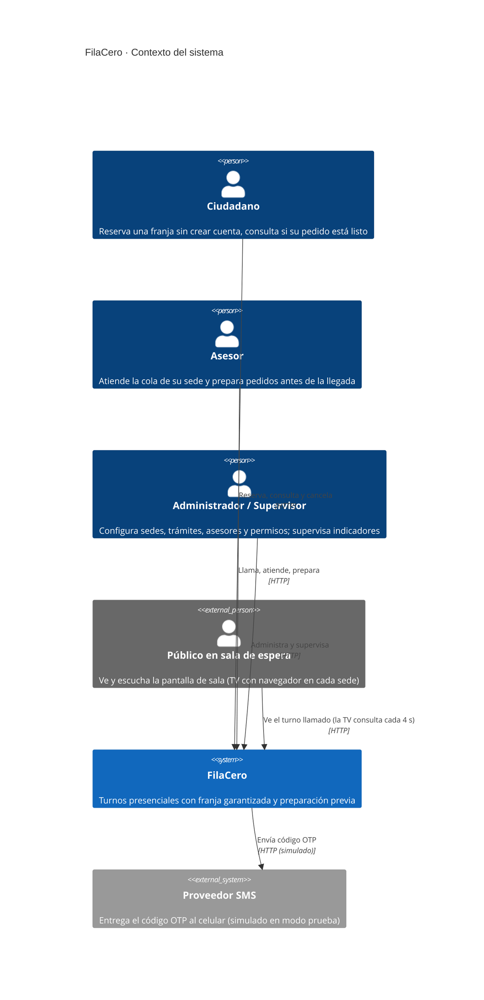
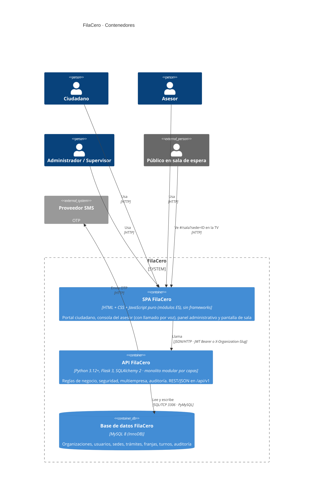
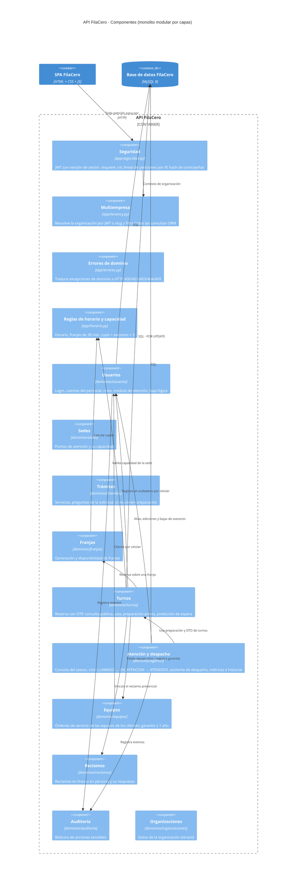
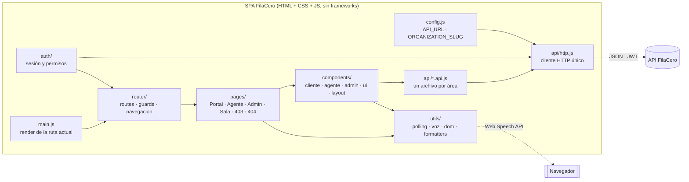

# 03 · Vistas C4

Las tres vistas responden preguntas distintas y **conservan los mismos nombres y límites**:

| Vista | Pregunta | Elementos |
|---|---|---|
| Contexto (C1) | ¿Quién usa FilaCero y con qué sistemas habla? | Actores + sistema FilaCero + sistemas externos |
| Contenedores (C2) | ¿Qué unidades ejecutables/desplegables lo componen? | SPA FilaCero · API FilaCero · Base de datos FilaCero |
| Componentes (C3) | ¿Qué módulos hay dentro de la API y de la SPA? | Módulos de dominio por capas + componentes transversales |

> Los diagramas están en Mermaid (se renderizan en GitHub, VS Code con la extensión *Markdown Preview Mermaid*
> y en mermaid.live). Debajo de cada uno hay una tabla con las mismas relaciones por si el visor no los dibuja.

## C1 · Diagrama de contexto



| Origen | Destino | Interacción |
|---|---|---|
| Ciudadano | FilaCero | Reserva con OTP, consulta estado y preparación, cancela |
| Asesor | FilaCero | Consola: llamar (con voz), iniciar, finalizar, no asistió, preparar pedido |
| Administrador / Supervisor | FilaCero | Panel: resumen en vivo, sedes, trámites, asesores, usuarios, historial, actividad |
| Público en sala (TV) | FilaCero | Lectura pública del turno llamado, módulo y próximos turnos |
| FilaCero | Proveedor SMS | Envío del OTP (en localhost el código se muestra en pantalla: `FILACERO_OTP_TEST_MODE=true`) |

## C2 · Diagrama de contenedores



| Contenedor | Tecnología | Responsabilidad | Se comunica con |
|---|---|---|---|
| **SPA FilaCero** | HTML5 + CSS3 + JavaScript puro (módulos ES, `fetch`), **sin frameworks ni librerías**, sin compilación | Presentación, navegación por rutas `#/` (`hashchange`), guardas de rol, voz (Web Speech API), escape de HTML contra XSS | API FilaCero (REST JSON) |
| **API FilaCero** | Flask 3, SQLAlchemy 2, Flask-JWT-Extended, Marshmallow, Alembic | Toda regla de negocio y de seguridad; nunca confía en la SPA | Base de datos FilaCero, Proveedor SMS |
| **Base de datos FilaCero** | MySQL 8 / InnoDB, `utf8mb4` | Persistencia transaccional; bloqueos de fila para cupos | — |

Notas de coherencia:
- La **pantalla de sala no es otro contenedor**: es una ruta pública (`#/sala?sede=ID`) de la misma SPA, abierta en una TV.
- El **llamado por voz** no es un servicio: es una capacidad del navegador usada por la SPA (ADR-009).
- La API es **un solo proceso desplegable**; los módulos internos se ven en C3.

## C3 · Componentes de la API FilaCero



Cada módulo de dominio repite la misma **estructura por capas**:

| Capa | Archivo | Responsabilidad | Puede depender de |
|---|---|---|---|
| Controlador (presentación HTTP) | `controladores.py`, `admin_controladores.py` | Recibir la petición, validar rol, devolver JSON | Servicios, DTO, Seguridad, Auditoría |
| Servicio (aplicación / negocio) | `servicios.py`, `despacho.py`, `preparacion.py` | Reglas de negocio y transacciones | Repositorios, Modelos, Horario, Errores |
| Repositorio (acceso a datos) | `repositorios.py` | Consultas reutilizables, bloqueos | Modelos |
| Modelo (persistencia) | `modelos.py` | Entidades SQLAlchemy | `TenantScoped` |
| DTO (contrato) | `dtos.py` | Forma pública de los datos (incluye versiones públicas que enmascaran) | Modelos |

## C3 · Componentes de la SPA FilaCero

La SPA no usa frameworks: es HTML + CSS + JavaScript puro organizado en las mismas capas del proyecto de
referencia (*frontend-alojamientos*). Detalle en [`frontend/docs/ARQUITECTURA-SPA-VANILLA.md`](../../frontend/docs/ARQUITECTURA-SPA-VANILLA.md).



| Componente SPA | Responsabilidad |
|---|---|
| `main.js` | Escucha `hashchange`, resuelve la ruta y pinta `XPage()` en `#app`; ejecuta la limpieza de la página anterior (sondeos, relojes, voz) |
| `router/` | Tabla de rutas y guardas por rol (`#/`, `#/sala`, `#/agente`, `#/admin/:seccion`, `#/cambiar-clave`); decide página, redirección, 403 o 404 |
| `pages/` | Una página por vista principal con el patrón `XPage()` (HTML) + `mountXPage()` (eventos y datos) |
| `components/admin/tablaSeccion.js` + `ui/modal.js` (`abrirDetalle`) | Patrón uniforme del panel: tabla de 6 columnas (un dato por columna) y detalle al hacer clic |
| `components/agente/prepararTurno.js` | Preparación previa del pedido |
| `components/cliente/reservarTurno.js` | Asistente de reserva: pasos según el tipo de trámite (entrega, garantía, reclamo, general) |
| `components/agente/equipos.js`, `reclamos.js`, `presencia.js` | Tablero del taller, bandeja de reclamos con minichat y estado del asesor en la consola |
| `utils/voz.js` | Anuncio y repetición cada 20 s del turno llamado (Web Speech API) |
| `utils/polling.js` | `crearSondeo()`: consulta periódica que se pausa con la pestaña oculta y conserva el último dato si falla |
| `utils/dom.js` | Plantilla `html``…``` que **escapa toda interpolación** (protección contra XSS) |
| `api/http.js` | Único punto que usa `fetch`: token, slug de organización, errores, aviso de servidor lento |

## Trazabilidad C2 ↔ código ↔ despliegue

| Contenedor | Código | Unidad ejecutable | Nodo (ver [06](06-despliegue.md)) |
|---|---|---|---|
| SPA FilaCero | `frontend/index.html`, `frontend/src/js`, `frontend/src/css` | Archivos estáticos sin compilar servidos con `python -m http.server 5173` (o Live Server) | Equipo de demostración |
| API FilaCero | `backend/app` | Proceso Python (`python run.py` o `waitress-serve run:app`) | Equipo de demostración |
| Base de datos FilaCero | `backend/migrations` | Servicio `mysqld` | Equipo de demostración |
