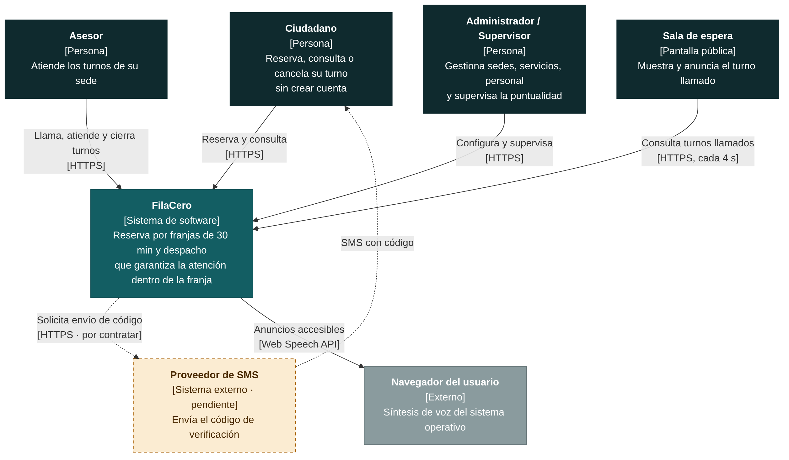
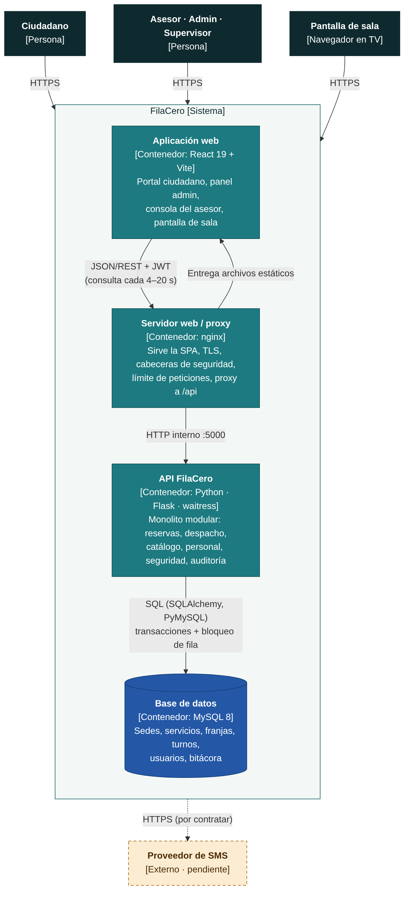
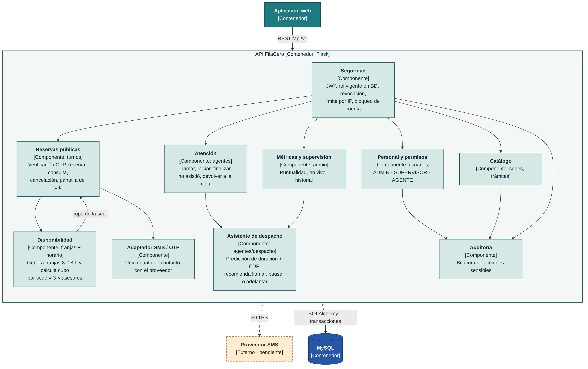

# 3. Vistas C4

Cada nivel responde una pregunta distinta y conserva los mismos nombres que usan los ADR y el código.

## 3.1 C4 Context — ¿quién usa FilaCero y con qué sistemas se relaciona?

- **Personas:** ciudadano, asesor, administrador/supervisor y la pantalla de la sala de espera.
- **Sistemas externos:** el **proveedor de SMS** (por contratar, por eso aparece punteado) y la síntesis de voz del navegador.
- **Decisión visible en este nivel:** el ciudadano interactúa sin cuenta; la identidad se apoya en su celular (ADR-0008).

## 3.2 C4 Container — ¿cuáles son las unidades ejecutables y de datos?

| Contenedor | Tecnología | Responsabilidad | Por qué existe (decisión) |
|---|---|---|---|
| Aplicación web | React 19 + Vite (SPA) | Las 4 experiencias: portal, panel, consola, sala | Una sola base de código para todos los roles; se sirve como archivos estáticos |
| Servidor web / proxy | nginx | TLS, cabeceras de seguridad (CSP, HSTS), límite de peticiones, proxy `/api` | Mismo dominio para web y API → sin CORS en producción (ADR-0006) |
| API FilaCero | Python 3.13, Flask, waitress | Reglas de negocio, seguridad, despacho, auditoría | Monolito modular (ADR-0001) |
| Base de datos | MySQL 8 | Estado persistente y transaccional | Reglas de cupo requieren transacciones y bloqueo de fila (ADR-0004) |

## 3.3 C4 Component — ¿cómo se organiza internamente la API?

Se detalla la **API** porque concentra las reglas que sostienen la promesa de puntualidad.

| Componente | Responsabilidad | Ofrece | Depende de | Razón de la dependencia |
|---|---|---|---|---|
| Seguridad | Autenticar (JWT), autorizar por rol vigente, revocar, limitar intentos | Decoradores `requiere_rol`, `limitar` | Usuarios, Auditoría | El rol se lee de la BD, no solo del token |
| Reservas públicas | OTP, reservar, consultar, cancelar, pantalla de sala | `/turnos/publico/*` | Disponibilidad, Adaptador SMS/OTP | Validar cupo y celular antes de crear el turno |
| Disponibilidad | Generar franjas y calcular cupo por sede | `/franjas/disponibles`, `capacidad_sede()` | Personal (asesores activos) | El cupo = 3 × asesores activos |
| Asistente de despacho | Predecir duración, ordenar por plazo (EDF), recomendar | `proyectar_cola()`, `recomendar()` | Turnos (historial) | Aprende de las atenciones anteriores |
| Atención | Ciclo llamar → iniciar → finalizar / no asistió | `/agente/*` | Asistente de despacho | La consola recibe la recomendación en la misma llamada |
| Catálogo | Sedes y servicios | `/sedes`, `/tramites` | Auditoría | Cambios trazables |
| Personal y permisos | Cuentas, roles, claves temporales | `/admin/usuarios` | Auditoría, Seguridad | Revoca sesiones al cambiar rol o clave |
| Métricas y supervisión | Puntualidad, en vivo, historial | `/admin/agentes/*` | Asistente de despacho | Reutiliza la proyección para "en riesgo" |
| Auditoría | Bitácora de acciones sensibles | `registrar()`, `/admin/usuarios/auditoria` | — | Transversal, no bloquea la operación si falla |
| Adaptador SMS / OTP | Único punto de contacto con el proveedor | `generar_codigo()`, `verificar_codigo()` | Proveedor SMS | Aísla la integración externa (ver evolución) |

**Revisión de dependencias:** no hay dependencias circulares entre dominios; la integración externa está encapsulada en un solo componente; las reglas de cupo viven solo en *Disponibilidad* (`app/horario.py`) y se reutilizan en la reserva.

## 3.4 Trazabilidad entre vistas

| Elemento | Context | Container | Component | Despliegue |
|---|---|---|---|---|
| Ciudadano | Persona | → nginx → SPA / API | Reservas públicas | Navegador → `web` |
| Asesor | Persona | → SPA consola | Atención + Asistente de despacho | PC del puesto → `web` |
| Capacidad principal (reserva puntual) | FilaCero | API + MySQL | Disponibilidad + Reservas | `api` + `db` |
| Persistencia | — | MySQL | Repositorios SQLAlchemy | `db` + volumen `datos_mysql` |
| Integración crítica (SMS) | Proveedor SMS | API → externo | Adaptador SMS/OTP | Salida HTTPS desde `api` |
