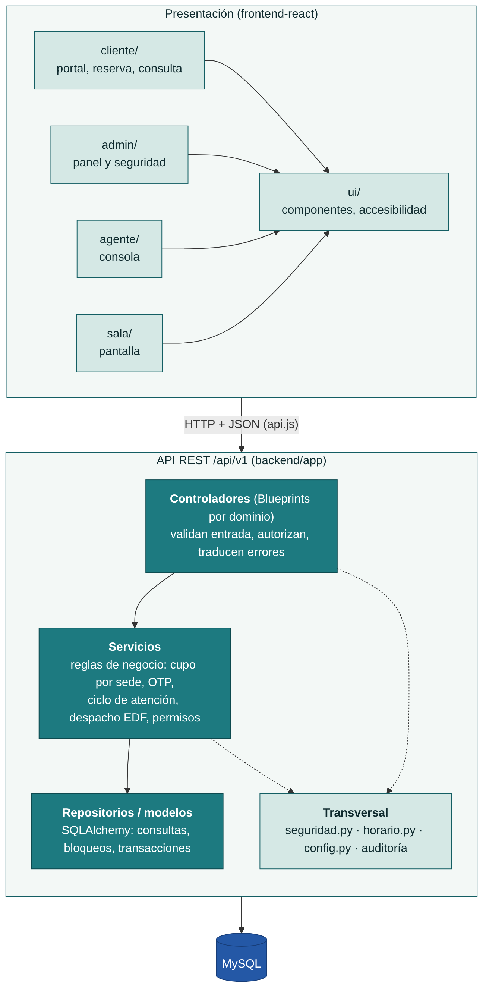
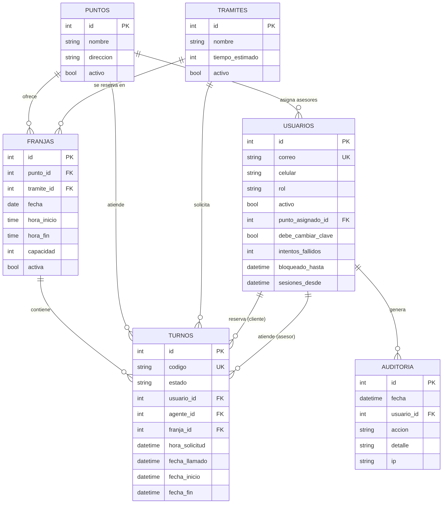

# 4. Arquitectura lógica



## 4.1 Organización

**Monolito modular por dominios** (ADR-0001). La API es un único desplegable, organizado internamente en dominios con límites explícitos:

```
backend/app/
├── __init__.py          # fábrica de la app, CORS, cabeceras, errores, JWT
├── config.py            # configuración por entorno + validación de producción
├── seguridad.py         # hashing, roles, límite por IP, validaciones
├── horario.py           # reglas de horario, franjas y CUPO POR SEDE
└── dominios/
    ├── usuarios/        # cuentas, login, permisos (admin_controladores)
    ├── sedes/           # catálogo de puntos de atención
    ├── tramites/        # catálogo de servicios
    ├── franjas/         # disponibilidad y franjas
    ├── turnos/          # reserva pública, OTP, consulta, sala, predicción
    ├── agentes/         # atención, métricas y despacho.py (EDF)
    └── auditoria/       # bitácora
```

Cada dominio sigue el mismo patrón de capas:

| Capa | Responsabilidad | Ejemplo |
|---|---|---|
| Controlador (Blueprint) | Validar entrada, autorizar, traducir errores a HTTP | `turnos/controladores.py` |
| DTO | Forma pública de los datos (y qué se oculta) | `turno_publico_response` enmascara el celular |
| Servicio | Reglas de negocio y transacciones | `turnos/servicios.py::crear_turno` |
| Repositorio / modelo | Consultas, bloqueos, mapeo a tablas | `turnos/repositorios.py::consulta_cola` |

## 4.2 Reglas de dependencia

1. Los controladores no hablan con la base de datos directamente salvo consultas de lectura simples de métricas.
2. Las **reglas de cupo** existen en un solo lugar (`horario.capacidad_sede`, `ocupacion_sede`) y las usan tanto la disponibilidad como la reserva: si cambian, cambian en ambas.
3. La **integración externa** (SMS) solo se toca desde `turnos/otp.py`.
4. La **auditoría** es transversal y tolerante a fallos: si no puede registrar, no interrumpe la operación.
5. El frontend solo conoce la API REST (`src/api.js`); no hay lógica de cupo en el navegador.

## 4.3 Integración interna

| Interacción | Quién solicita | Quién responde | Dependencia temporal |
|---|---|---|---|
| Reservar | SPA (ciudadano) | Reservas → Disponibilidad | Síncrona: el ciudadano necesita el código en el momento |
| Panel del asesor | SPA (consola, cada 5 s) | Atención → Despacho | Síncrona por consulta periódica (ADR-0005) |
| Supervisión | SPA (admin, cada 15 s) | Métricas → Despacho | Síncrona por consulta periódica |
| Pantalla de sala | SPA en TV (cada 4 s) | Reservas (`/publico/sala`) | Síncrona, sin autenticación, sin datos sensibles |
| Envío de SMS | Adaptador OTP | Proveedor externo | Síncrona hoy; ver escenario de evolución |

## 4.4 Persistencia



| Dato | Responsable | Consistencia requerida |
|---|---|---|
| Turnos y su estado | Reservas / Atención | **Fuerte**: el cupo se verifica y el turno se inserta en la misma transacción |
| Franjas | Disponibilidad | Se generan una vez por sede/servicio/día; restricción única evita duplicados |
| Usuarios, roles, bloqueo, revocación | Personal y permisos | Fuerte: un cambio de rol aplica en la siguiente petición |
| Bitácora | Auditoría | Eventual: se registra después de la operación principal |
| Códigos OTP y contadores de límite por IP | Memoria del proceso | Volátil, se pierde al reiniciar (aceptado, ver riesgo R3) |

Las migraciones del esquema se versionan con Alembic (`backend/migrations/versions`).
