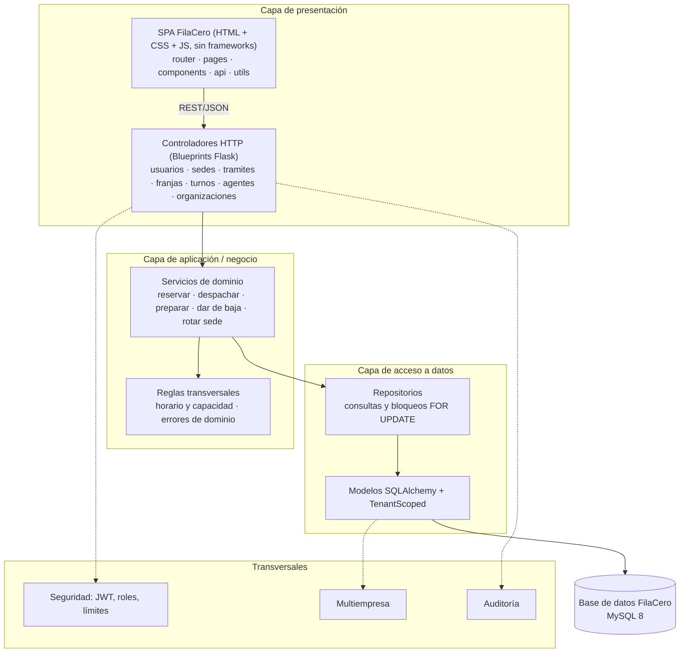
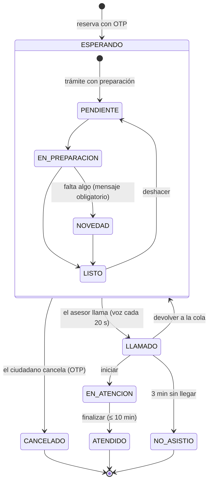
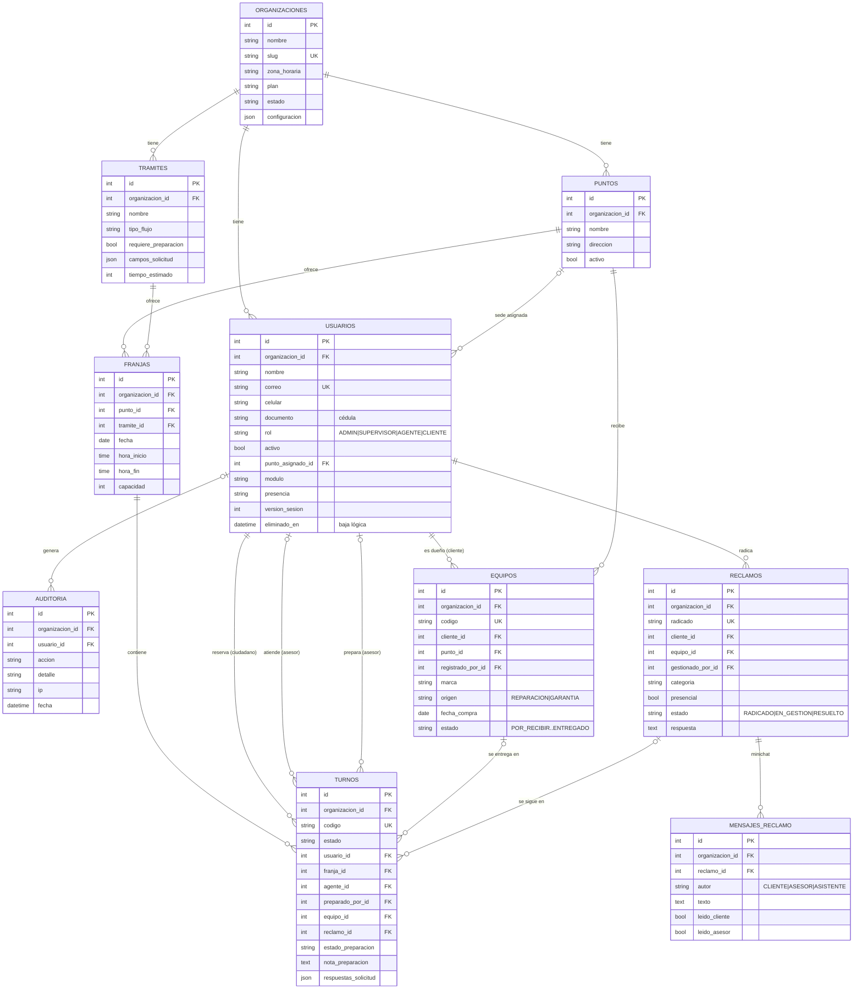

# 04 · Arquitectura lógica

## 1. Estilo: monolito modular por capas

FilaCero es **un solo proceso backend** dividido en **módulos de dominio** (corte vertical por negocio) y,
dentro de cada módulo, **capas** (corte horizontal por responsabilidad). La SPA es un contenedor aparte que
solo conoce la API pública `/api/v1`.



### Reglas de dependencia

1. Las dependencias van **hacia abajo**: controlador → servicio → repositorio → modelo. Nunca al revés.
2. Un módulo usa a otro **a través de su servicio o DTO**, no de su controlador (p. ej. *Atención y despacho*
   usa `turnos.preparacion` y `usuarios.servicios.dar_de_baja`).
3. Las reglas de capacidad viven en **un solo lugar** (`app/horario.py`); reserva, disponibilidad, despacho y
   panel las consultan, no las duplican.
4. Las excepciones de dominio (`DatosInvalidosError`, `ConflictoError`, `NoEncontradoError`…) se lanzan en la
   capa de servicio y se traducen a HTTP en un único manejador (`app/errores.py`).
5. Los DTO definen el contrato: `turno_response` (personal) y `turno_publico_response` (ciudadano, sin IDs
   internos y con celular enmascarado) son representaciones distintas de la misma entidad.

> **Deuda técnica corregida (R-07, entrega final)**: los endpoints de métricas, historial, asesores, sala,
> disponibilidad, usuarios y organización ya no consultan la base de datos desde el controlador. Las consultas
> están en `repositorios.py`, las reglas en `servicios.py` / `admin_servicios.py` / `consultas.py` y las respuestas
> en `dtos.py`. Los controladores tampoco importan repositorios: las lecturas simples pasan por funciones del servicio
> (`buscar_turno_por_codigo`, `equipos_de_sede`, `reclamos_de_sede`, `obtener_asesor`…). La regla 1 la verifica
> `tests/test_arquitectura_capas.py` (ADR-017).

> **Excepción declarada a la regla 2 (acoplamiento por modelo)**: algunos módulos importan el **modelo** de otro
> para contar o validar, con importación diferida para no crear ciclos de arranque: `franjas` y `usuarios` leen
> `turnos.modelos.Turno` (cupos ocupados, turno en curso), `sedes` lee `franjas.modelos.Franja` y
> `turnos.preparacion` usa `agentes.repositorios.obtener_agente`. Es un ciclo lógico `turnos ↔ agentes` aceptado
> dentro del mismo proceso (trade-off T-12 y riesgo R-11 en [09](09-tradeoffs-riesgos.md)); el plan es exponer
> esas consultas en `turnos/repositorios.py`. El [diagrama de paquetes](../diagramas/README.md) muestra todas las dependencias.

## 2. Módulos, responsabilidades y límites

| Módulo | Responsabilidad | Dueño de las tablas | No debe |
|---|---|---|---|
| `organizaciones` | Tenant: nombre, slug, zona horaria | `organizaciones` | Conocer turnos |
| `usuarios` | Identidad del personal y del ciudadano por celular; roles; **módulo de atención**; **baja lógica** | `usuarios` | Decidir cupos |
| `sedes` | Puntos de atención; capacidad visible para el panel | `puntos` | Gestionar asesores |
| `tramites` | Catálogo de servicios, preguntas de la solicitud, **si requiere preparación** | `tramites` | Reservar |
| `franjas` | Franjas de 30 min y disponibilidad | `franjas` | Modificar turnos |
| `turnos` | Reserva pública con OTP, consulta, cancelación, sala, **preparación previa**, predicción de espera | `turnos` | Autenticar personal |
| `agentes` (Atención y despacho) | Ciclo de atención, asistente de despacho, consola, métricas, historial | — (usa `turnos`, `usuarios`) | Crear turnos |
| `equipos` | Órdenes de servicio de los equipos de los clientes; reglas de garantía (≤ 1 año) y de entrega (solo LISTO y del mismo celular) | `equipos` | Conocer el despacho |
| `reclamos` | Radicar, gestionar y responder reclamos | `reclamos` | Reservar turnos (lo hace `turnos`) |
| `auditoria` | Bitácora de acciones sensibles | `auditoria` | Interrumpir la operación si falla (registro "best effort") |
| `asistente` (FilaCero IA) | Analista del panel y copiloto del asesor: responde con datos reales reutilizando los servicios de `agentes`, `turnos`, `reclamos` y `franjas`; motor local y, opcionalmente, Claude | — (módulo de aplicación sin persistencia propia) | Acceder directamente a la base de datos ni saltarse permisos o el aislamiento multiempresa |

## 3. Ciclo de vida del turno (con preparación previa)



La preparación es **ortogonal** al estado de atención: se puede preparar mientras el turno está en espera,
llamado o en atención, y queda registrada (quién, cuándo, mensaje) para el historial.

## 4. Integración

### 4.1 SPA ↔ API (síncrona, REST/JSON)

| Aspecto | Decisión |
|---|---|
| Versionado | Prefijo `/api/v1` en todos los recursos |
| Autenticación | `Authorization: Bearer <JWT>` para personal; `X-Organization-Slug` para peticiones públicas |
| Errores | JSON uniforme `{"error": "...", "success": false}` con código HTTP semántico (400/401/403/404/409/429) |
| Actualización en vivo | Polling: sala 4 s, consola 5 s, asesores 10 s, resumen 15 s, historial/usuarios/portal 20 s, catálogo 30 s |
| Cliente único | `frontend/src/js/api/http.js` (ningún componente usa `fetch` directamente); URL y organización en `frontend/src/js/config.js` |

Endpoints agregados en la entrega final:

| Método y ruta | Rol | Propósito |
|---|---|---|
| `POST /api/v1/agente/turnos/{id}/preparacion` | AGENTE | Cambiar estado de preparación (`EN_PREPARACION`, `LISTO`, `NOVEDAD`, `PENDIENTE`) con mensaje |
| `DELETE /api/v1/admin/agentes/{id}` | ADMIN | Baja definitiva (lógica) de un asesor |
| `DELETE /api/v1/admin/usuarios/{id}` | ADMIN | Baja definitiva (lógica) de cualquier cuenta del personal |
| `POST /api/v1/equipos/publico/mios` | Ciudadano (OTP) | Sus equipos y su nombre registrado |
| `GET/POST /api/v1/equipos/`, `PUT /equipos/{id}/estado` | AGENTE (lectura también panel) | Taller de la sede: recibir y avanzar equipos. Registrar exige `cliente_documento`; pasar a `ENTREGADO` (o de `POR_RECIBIR` a `RECIBIDO`) exige `documento` y debe coincidir (iteración 3) |
| `GET /api/v1/admin/agentes/tablero?dias\|desde&hasta&punto_id` | ADMIN, SUPERVISOR (solo lectura) | Tablero ejecutivo: KPI del periodo y del anterior, serie diaria, demanda por hora, por sede y trámite, taller y reclamos (iteración 3) |
| `POST /api/v1/turnos/publico/consultar` y `/cancelar` | Ciudadano (OTP) | Aceptan el código completo, el visible `TU-XXXXXX` o los 6 caracteres; la verificación se valida **antes** de buscar (iteración 3) |
| `POST /api/v1/reclamos/publico`, `POST /reclamos/publico/mios` | Ciudadano (OTP) | Radicar y consultar reclamos |
| `GET /api/v1/reclamos/`, `PUT /reclamos/{id}` | AGENTE (lectura también panel) | Bandeja y respuesta |
| `PUT /api/v1/agente/presencia` | AGENTE | Disponible, pausa, almuerzo, fuera de turno |
| `POST /api/v1/turnos/publico` (ampliado) | Ciudadano (OTP) | Acepta `equipo_id` (entrega), `garantia{marca, fecha_compra, falla}` o `reclamo_id` según el tipo de trámite |

Campos agregados (cambios aditivos, compatibles): `modulo` en usuarios y sala; `requiere_preparacion` en
trámites; `preparacion` y `agente_modulo` en turnos; `asesores_activos` y `cupos_por_franja` en sedes (solo
para el panel); `resumen.por_preparar` en la consola.

### 4.2 API ↔ Proveedor SMS

Interfaz `turnos/otp.py`. En localhost (`FILACERO_OTP_TEST_MODE=true`) el código se devuelve en la respuesta
para la demostración, y **solo** a peticiones hechas desde el mismo equipo (127.0.0.1). El envío real por SMS
(`_enviar_sms`) es el punto de extensión identificado y queda fuera del alcance de la entrega.

### 4.3 SPA ↔ Navegador (Web Speech API)

El anuncio por voz no pasa por el servidor: `frontend/src/js/utils/voz.js` construye la frase
("Turno 1 2 0 4 8 9. *Nombre completo*, por favor acercarse al Módulo 2") y usa `speechSynthesis`. Ver ADR-009.

## 5. Persistencia



> Versión UML completa (con tipos SQL e índices): [`docs/diagramas/entidad-relacion.png`](../diagramas/entidad-relacion.png).

| Aspecto | Decisión y justificación |
|---|---|
| Motor | MySQL 8 InnoDB: transacciones ACID y bloqueo de fila, necesarios para RAR-01 (ADR-003) |
| Aislamiento | `READ COMMITTED` en MySQL (ADR-004 revisado) |
| Esquema | Versionado con Alembic: 15 migraciones encadenadas; las de la entrega final (`a7c9e1b3d5f7`, `b8d0f2a4c6e9`, `c1e3a5b7d9f0`, `d2f4b6c8e0a1`) son **aditivas** (tablas nuevas y columnas nulas o con valor por defecto) y reversibles |
| Multiempresa | Columna `organizacion_id` en cada tabla de negocio + filtro automático del ORM (ADR-006) |
| Integridad histórica | Nada que tenga turnos se borra físicamente: sedes y trámites se desactivan; cuentas se dan de baja lógica (ADR-011) |
| Pruebas | SQLite en memoria para la suite automatizada; la suite de concurrencia real se ejecuta contra MySQL con `simulacion.py --carga` |

## 6. Aspectos transversales

| Aspecto | Dónde | Cómo |
|---|---|---|
| Autenticación | `seguridad.py`, `usuarios/servicios.py` | JWT de 60 min con claim `ver` (versión de sesión) y `org_id` |
| Autorización | `@requiere_rol(...)` | Verifica el rol **vigente en base de datos**, no solo el del token |
| Límite de peticiones | `@limitar(...)` | Ventana por IP en memoria (login, OTP, público) |
| Auditoría | `auditoria/servicios.registrar` | Login, cambios de cuentas, catálogo, rotación de sede, preparación, bajas, equipos, reclamos y presencia |
| Accesibilidad | `utils/voz.js`, `ui/modal.js`, CSS | Paleta de alto contraste por defecto en el portal, regiones `aria-live`, foco atrapado en ventanas, navegación por teclado, llamado por voz |
| Configuración | `config.py` + `.env` (API) · `src/js/config.js` (SPA) | Valores por defecto pensados para localhost; aviso si `JWT_SECRET_KEY` es corta |
| Protección XSS en la SPA | `utils/dom.js` + CSP en `index.html` | La plantilla `html``…``` escapa toda interpolación; la política `script-src 'self'` (etiqueta `<meta>`) impide scripts en línea o de otros sitios |
