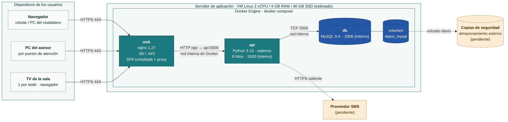

# 5. Arquitectura computacional, física y despliegue

## 5.1 Diagrama de despliegue

Archivos que lo materializan: `docker-compose.yml`, `backend/Dockerfile`, `frontend-react/Dockerfile`, `frontend-react/nginx.conf`, `deploy/.env.produccion.ejemplo`.

| Nodo / entorno | Unidad que ejecuta | Recursos | Comunicación |
|---|---|---|---|
| Navegador del ciudadano (celular/PC) | SPA compilada | Del usuario | HTTPS 443 → `web` |
| PC de cada puesto de atención | SPA (consola del asesor) | Del usuario | HTTPS 443 → `web` |
| TV de la sala (1 por sede) | SPA `/sala` | Navegador del TV o mini-PC | HTTPS 443 → `web`, consulta cada 4 s |
| VM Linux (servidor de aplicación) | Docker Compose: `web` (nginx), `api` (waitress), `db` (MySQL) | 2 vCPU / 4 GB RAM / 40 GB SSD (**estimado**, ver 5.3) | Red interna de Docker; solo `web` expone puertos |
| Volumen `datos_mysql` | Datos de MySQL | Disco de la VM | Volcado diario a almacenamiento externo (**pendiente**) |
| Proveedor SMS | Externo | — | HTTPS saliente desde `api` (**pendiente**) |

**Decisiones de despliegue reflejadas:** la base de datos **no** expone puertos fuera de la red interna; la API tampoco (solo nginx); el contenedor de la API corre con un usuario sin privilegios y tiene `HEALTHCHECK` contra `/health/listo`, que verifica la base de datos.

## 5.2 Mapeo lógico → físico

| Componente lógico | Contenedor | Nodo |
|---|---|---|
| Portal, panel, consola, sala | SPA (archivos estáticos) | Servido por `web`, ejecutado en el navegador |
| Seguridad, Reservas, Disponibilidad, Despacho, Atención, Catálogo, Personal, Métricas, Auditoría, Adaptador OTP | API | `api` (1 proceso, 8 hilos) |
| Turnos, franjas, usuarios, bitácora | Base de datos | `db` + volumen |
| Códigos OTP, contadores de límite por IP | Memoria de la API | `api` (volátil) |

## 5.3 Capacidad: carga esperada vs. medida

**Carga esperada en operación** (derivada de los supuestos S1, no medida en producción):

| Fuente | Frecuencia | Peticiones/s aprox. |
|---|---|---|
| 8 consolas de asesor | 1 cada 5 s | 1,6 |
| 5 pantallas de sala | 1 cada 4 s | 1,25 |
| 2–3 paneles de admin | 4 peticiones cada 15 s | ≈ 0,8 |
| Ciudadanos reservando (pico 10–11 a. m.) | ~6 peticiones por reserva | < 1 |
| **Total estimado en pico** | | **≈ 5 pet./s** |

**Carga medida** (`python simulacion.py --carga --url ... --usuarios 40 --segundos 20`):

| Operación | Peticiones | p50 | p95 | Máx | Errores |
|---|---|---|---|---|---|
| Consultar horario | 926 | 75 ms | 127 ms | 251 ms | 0 |
| Disponibilidad (franjas + cupo) | 926 | 141 ms | 218 ms | 341 ms | 0 |
| Pantalla de sala | 926 | 166 ms | 273 ms | 430 ms | 0 |
| **Rendimiento total** | | | | | **138,9 pet./s** |

Condiciones de la medición: contenedor Linux de **2 vCPU**, waitress con 8 hilos, base de datos **SQLite** con una semana simulada (~2.000 turnos), cliente y servidor en la misma máquina, límite por IP desactivado para la prueba.

**Lectura honesta del resultado:**
- Hay un margen aproximado de **25×** entre la carga esperada (≈ 5 pet./s) y la medida (≈ 139 pet./s).
- **No** se puede afirmar todavía la capacidad con MySQL ni a través de la red: queda como pendiente repetir la prueba en el servidor real (riesgo R6).
- Hipótesis: el recurso que limita es la **CPU** (el generador de carga y el servidor compartían las mismas 2 vCPU; no se midió el uso de CPU por proceso). Con SQLite la base de datos corre dentro del mismo proceso, así que **no se puede separar** cuánto consume la API y cuánto la BD: en el servidor real (MySQL en otro contenedor) debe observarse por separado.

## 5.4 Escalamiento

| Dimensión que crece | Qué observar primero | Respuesta proporcional |
|---|---|---|
| Más asesores o sedes | Tiempo de `/agente/panel` (proyección EDF) y `/publico/sala`; CPU de `api` vs. `db` | Escalar verticalmente la VM (más vCPU); subir hilos de waitress |
| Más ciudadanos reservando | Bloqueo por sede en reservas (las de una misma sede se serializan) | Aceptable: las reservas de sedes distintas no compiten |
| Más de una instancia de la API | Límite por IP y OTP en memoria dejan de ser compartidos | Mover ambos a Redis antes de escalar horizontalmente (ADR-0004, riesgo R3) |
| Volumen histórico | Tamaño de la tabla `turnos`; consultas de métricas por rango | Índices existentes por fecha/sede; archivar años anteriores |

## 5.5 Disponibilidad

| Punto único de fallo | Efecto | Mitigación actual | Pendiente |
|---|---|---|---|
| VM única | Todo el sistema cae | `restart: unless-stopped`; reinicio en segundos | Copia de la VM o segundo servidor si el negocio lo exige |
| MySQL | No se puede reservar ni atender | Volumen persistente; `/health/listo` responde 503 | Respaldo diario + prueba de restauración |
| Proveedor SMS | No se puede verificar el celular | Hoy: modo prueba. Futuro: degradación a verificación en sede (ver evolución) | Contratar proveedor y definir SLA |
| Red de la sede | El asesor no ve la cola | El turno ya reservado se conserva; al volver la red el panel se actualiza solo | Plan B en papel con la lista del día (operativo) |

El servicio se ofrece de 8:00 a 18:00; las ventanas de mantenimiento pueden hacerse fuera de ese horario.
