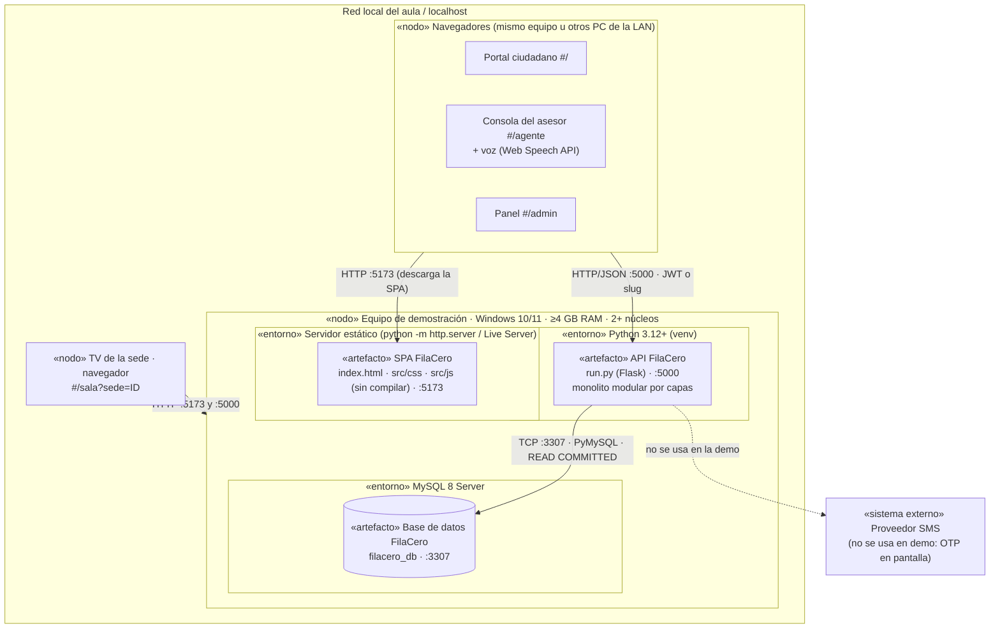

# 06 · Diagrama de despliegue

El despliegue conecta las **unidades lógicas** (contenedores C2) con **nodos y entornos de ejecución**.
Los nombres coinciden con [03](03-vistas-c4.md) y [05](05-arquitectura-fisica.md).

## 1. Despliegue seleccionado: un nodo local (demostración)

### Correspondencia lógica ↔ física

| Contenedor (C2) | Artefacto desplegado | Entorno de ejecución | Nodo | Orden de arranque |
|---|---|---|---|---|
| Base de datos FilaCero | Esquema `filacero_db` (migraciones Alembic) | MySQL 8 | Equipo de demostración | 1 |
| API FilaCero | Paquete `backend/app` + `run.py` | Python venv | Equipo de demostración | 2 (`flask --app run db upgrade` y `python run.py`) |
| SPA FilaCero | `frontend/index.html` + `src/css` + `src/js` (archivos estáticos, sin compilar) | Servidor estático de Python | Equipo de demostración | 3 (`cd frontend` y `python -m http.server 5173`) |
| — | Pantalla de sala | Navegador de la TV | TV de la sede | 4 (abrir `http://<ip>:5173/#/sala?sede=ID`) |

Para usar otros equipos de la LAN (por ejemplo una TV), arranque la API escuchando en la IP del equipo
(`FLASK_HOST=0.0.0.0`) y el servidor estático con `python -m http.server 5173 --bind 0.0.0.0`, y agregue el origen
`http://<ip>:5173` a `CORS_ALLOWED_ORIGINS`. `frontend/src/js/config.js` arma la dirección de la API con el mismo
equipo desde el que se abrió la página, así que no hay que cambiarlo.

> La versión UML de este diagrama (nodos, entornos de ejecución y artefactos)
> está en [`docs/diagramas/despliegue.png`](../diagramas/despliegue.png).

## 2. Alcance: solo localhost

La entrega se ejecuta y se demuestra **únicamente en localhost** (un equipo, tres procesos). No hay despliegue
en internet ni en servidores: el repositorio no incluye contenedores, servidor web de producción ni configuración
de nube. Las alternativas (contenedores, PaaS, VM) se compararon en [05 §6](05-arquitectura-fisica.md#6-alternativas-de-ejecución-comparadas)
y se descartaron en [ADR-012](adr/ADR-012-despliegue-en-un-nodo.md).

| Paso | Orden | Comprobación |
|---|---|---|
| 1 | Iniciar MySQL | El servicio escucha en el puerto de `backend/.env` (3307 en el equipo de demostración) |
| 2 | `cd backend` · `flask --app run db upgrade` · `python run.py` | `http://127.0.0.1:5000/health` responde `{"status": "ok"}` |
| 3 | `cd frontend` · `python -m http.server 5173` | `http://localhost:5173` muestra el portal |
| 4 | Abrir `#/agente`, `#/admin` y `#/sala?sede=ID` | La consola, el panel y la sala se actualizan solos (polling) |

> Si la evolución exigiera **varios procesos** de API, el candado en memoria de ADR-004 dejaría de bastar por sí
> solo; la consistencia la seguiría garantizando el `SELECT … FOR UPDATE` sobre la sede en MySQL. Por eso
> ADR-004 combina ambos mecanismos (escenario E-2 en [10](10-evolucion.md)).
