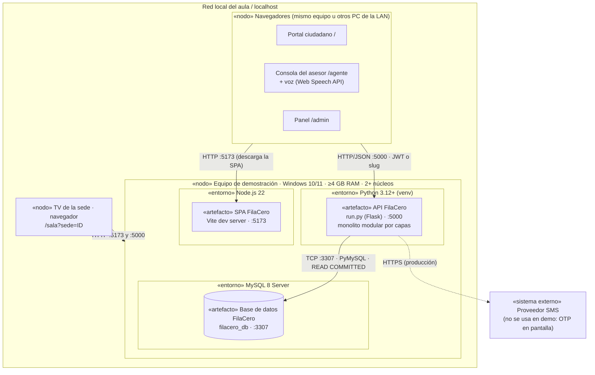
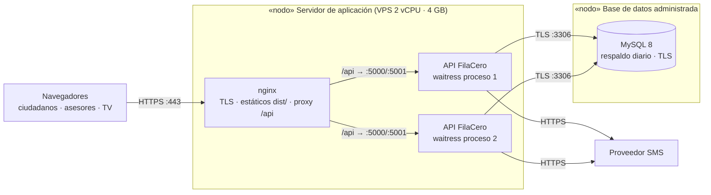

# 06 · Diagrama de despliegue

El despliegue conecta las **unidades lógicas** (contenedores C2) con **nodos y entornos de ejecución**.
Los nombres coinciden con [03](03-vistas-c4.md) y [05](05-arquitectura-fisica.md).

## 1. Despliegue seleccionado: un nodo local (demostración)

### Correspondencia lógica ↔ física

| Contenedor (C2) | Artefacto desplegado | Entorno de ejecución | Nodo | Orden de arranque |
|---|---|---|---|---|
| Base de datos FilaCero | Esquema `filacero_db` (migraciones Alembic) | MySQL 8 | Equipo de demostración | 1 |
| API FilaCero | Paquete `backend/app` + `run.py` | Python venv | Equipo de demostración | 2 (`flask --app run db upgrade` y `python run.py`) |
| SPA FilaCero | `frontend/src` servido por Vite | Node.js | Equipo de demostración | 3 (`npm run dev`) |
| — | Pantalla de sala | Navegador de la TV | TV de la sede | 4 (abrir `/sala?sede=ID`) |

Para usar otros equipos de la LAN (por ejemplo una TV), arranque la API y Vite escuchando en la IP del equipo
(`FLASK_HOST=0.0.0.0`, `npm run dev -- --host`), agregue el origen a `CORS_ALLOWED_ORIGINS` y apunte
`VITE_API_URL` a esa IP.

## 2. Despliegue objetivo (producción, evolución)

Mismas unidades lógicas, distinta materialización. No se ejecuta en esta entrega; se deja definido para
mostrar que la arquitectura lógica **no cambia** al pasar a producción (ADR-012).

Cambios que exige pasar de §1 a §2 (todos de configuración, ninguno de código):
`FLASK_ENV=production`, `FILACERO_OTP_TEST_MODE=false`, secretos de ≥ 32 caracteres, `CORS_ALLOWED_ORIGINS`
con el dominio real, `PROXIES_CONFIABLES=1`, `DB_SSL_CA` y build `npm run build`. La API valida esto al arrancar
y se niega a iniciar con configuración insegura.

Para una demostración pública sin SMS, se puede activar `FILACERO_OTP_DEMO_ENABLED=true` y definir
`FILACERO_OTP_DEMO_PHONE` y `FILACERO_OTP_DEMO_CODE`. Solo ese celular podrá verificarse y la API mostrará
el código; debe ser un teléfono dedicado, nunca uno de clientes. Este modo no prueba la posesión del celular
y no es apto para operar con datos reales. Para producción real se requiere integrar un proveedor SMS.

> Con **varios procesos** de API, el candado en memoria de ADR-004 ya no basta por sí solo; la consistencia la
> garantiza el `SELECT … FOR UPDATE` sobre la sede en MySQL, que sí es compartido entre procesos. Por eso
> ADR-004 combina ambos mecanismos.
