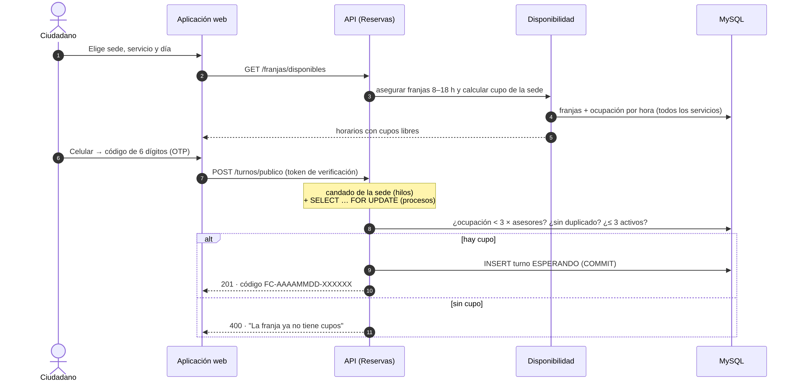

# 6. Integración y persistencia

## 6.1 Flujo crítico: reservar sin sobrecupo

1. La disponibilidad calcula cupos **por sede y hora**, sumando todos los servicios (RAR-03).
2. El ciudadano verifica su celular con un código de 6 dígitos (5 intentos, vigencia 5 min).
3. La reserva toma el **candado de la sede** (hilos del proceso) y `SELECT … FOR UPDATE` sobre la sede (procesos en MySQL); vuelve a contar la ocupación dentro de la transacción y solo entonces inserta (ADR-0004).

## 6.2 Contratos de la API

- Estilo **REST/JSON** versionado bajo `/api/v1`; 52 rutas.
- Errores uniformes `{"error": "mensaje en español"}` con códigos 400 / 401 / 403 / 404 / 429 / 503; nunca se exponen trazas internas.
- Autenticación `Authorization: Bearer <JWT>` para personal; las rutas públicas (`/turnos/publico/*`, `/franjas/disponibles`, `/horario`, `/sedes`, `/tramites`) tienen límite por IP.
- Colección Postman de referencia: `backend/docs/postman/`.

## 6.3 Sincronía y asincronía

| Interacción | Modo | Justificación |
|---|---|---|
| Reserva, consulta, cancelación | Síncrona | El ciudadano necesita la respuesta (código) en el momento |
| Actualización de consola, panel y sala | Consulta periódica (4–20 s) | Suficiente para RAR-04 y simple de operar detrás de nginx (ADR-0005) |
| Bitácora | Síncrona pero tolerante a fallos | Si falla el registro no se pierde la operación principal |
| Envío de SMS | Síncrona hoy (modo prueba) | Ver escenario de evolución: pasar a envío con reintento y estado |

## 6.4 Integración externa: proveedor de SMS

| Pregunta (guía 15, §8.1) | Respuesta |
|---|---|
| ¿Qué capacidad aporta? | Entregar el código de verificación del celular |
| ¿Quién inicia? | La API (`turnos/otp.py`), cuando el ciudadano pide el código |
| ¿Qué información se envía? | Solo el número de celular y el código; ningún otro dato personal |
| ¿Síncrona o diferible? | El ciudadano espera el código, pero el envío puede tardar segundos: timeout corto + estado |
| ¿Qué pasa si está lento o caído? | Hoy: la API responde 503 "verificación no disponible" (sin crear reservas no verificadas). Propuesta: ver `09-evolucion.md` |
| Datos sensibles / credenciales | Credencial del proveedor como variable de entorno; nunca en el código |
| Contrato o supuesto | SLA y costo por mensaje **pendientes de cotizar** |
| Vistas afectadas | Context, Container, Component (Adaptador SMS/OTP), despliegue (salida HTTPS), ADR-0008 |

**Pregunta de la guía 16 (§13.2): "una integración externa crítica tarda varios segundos o queda no disponible".** Lo primero que se revisaría es el **Adaptador SMS/OTP**, porque es el único punto de contacto con el proveedor. La arquitectura ya aísla el impacto: la reserva, la atención y la supervisión no dependen del SMS, solo la verificación previa a reservar. El escenario completo y el ajuste propuesto están en `09-evolucion.md`.

## 6.5 Persistencia

- **Motor:** MySQL 8 (InnoDB) en producción. En pruebas se usa SQLite en memoria; las reglas de concurrencia se verifican además con la prueba de carga.
- **Integridad declarativa:** claves foráneas; `UNIQUE(punto, tramite, fecha, hora_inicio)` en franjas; `UNIQUE(codigo)` en turnos; `CHECK capacidad > 0` y `hora_fin > hora_inicio`.
- **Integridad por reglas:** cupo por sede, un turno por persona y franja, máximo 3 turnos activos por persona.
- **Zona horaria:** las marcas de tiempo se guardan en UTC y se presentan en hora de Bogotá; las franjas se guardan como fecha y hora locales del servicio.
- **Datos personales mínimos:** nombre y celular del ciudadano; correo interno sintético; sin contraseña para ciudadanos.
- **Evolución del esquema:** 7 migraciones Alembic versionadas.
