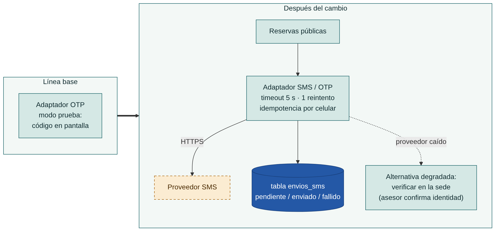

# 9. Evolución de la arquitectura ante escenarios de cambio

## 9.1 Evolución ya ocurrida durante el semestre

| Línea base | Cambio detectado | Decisión | Artefactos actualizados |
|---|---|---|---|
| Cupo **por trámite** | Una sede con 4 servicios aceptaba 12 personas por media hora con 1 asesor | Cupo **por sede** = 3 × asesores (ADR-0002) | `horario.py`, disponibilidad, reserva, C4 Component, `test_despacho.py` |
| Cola ordenada por hora de **solicitud** | Quien reservó para otro día pasaba antes que el de hoy | Orden por plazo de la franja (EDF) (ADR-0003) | `despacho.py`, consola del asesor |
| Verificar cupo y luego insertar | La prueba de carga aceptó 7 reservas con 6 cupos | Candado por sede + `FOR UPDATE` (ADR-0004) | `turnos/servicios.py`, nueva prueba de concurrencia |
| Rol leído solo del token | Un asesor degradado seguía operando 60 min | Rol validado en BD + revocación (ADR-0007) | `seguridad.py`, `__init__.py`, migración `d4f6b8c0e2a3` |

## 9.2 Escenario de cambio principal: integración real con proveedor de SMS (escenario C + D de la guía 15)

| Elemento | Registro |
|---|---|
| **Línea base** | El código OTP se genera en memoria y, en desarrollo, se muestra en pantalla. En producción la reserva pública responde 503 porque no hay proveedor. |
| **Cambio / estímulo** | TecniVisión contrata un proveedor de SMS. Durante picos el proveedor tarda 3–8 s o falla temporalmente. |
| **Contexto** | 10–11 a. m., la hora de mayor demanda; ciudadanos reservando desde el celular. |
| **Parte afectada** | Adaptador SMS/OTP (componente); salida HTTPS de `api` (despliegue); actor externo en Context; ADR-0008. |
| **Respuesta esperada** | Ninguna petición de la API queda bloqueada más de 5 s; el ciudadano sabe qué pasó; no se crean reservas sin verificar; el resto del sistema (atención, panel, sala) sigue funcionando. |
| **Criterio / evidencia** | p95 de `/solicitar-codigo` < 6 s con el proveedor lento (simulado con un retardo); 0 reservas sin verificar; la atención no se ve afectada. |
| **Información faltante** | SLA y costo por mensaje del proveedor; si permite entrega por WhatsApp como canal alterno. |

### Cadena de impacto

Escenario → **RAR-05** (reservar sin cuenta verificando el celular) → atributos **disponibilidad** y **seguridad** → componente **Adaptador SMS/OTP** → vistas **Context / Container / Component / despliegue** → riesgo **R4** → **ADR-0008** (se complementa) → evidencia: prueba con proveedor simulado lento.

### Matriz de impacto

| Elemento | Sin impacto | Impacto posible | Impacto confirmado | Justificación |
|---|:-:|:-:|:-:|---|
| Problema y alcance | ✓ | | | La promesa no cambia |
| RAR | | | ✓ | RAR-05 pasa a depender de un tercero |
| Atributos de calidad | | | ✓ | Disponibilidad de la reserva en línea depende del proveedor |
| C4 Context | | | ✓ | El proveedor deja de estar "pendiente" |
| C4 Container | | ✓ | | Solo si se agrega un trabajador asíncrono (no en el cambio mínimo) |
| C4 Component | | | ✓ | El adaptador gana timeout, reintento y estado de envío |
| Integración / persistencia | | | ✓ | Nueva tabla `envios_sms` (pendiente/enviado/fallido) |
| Arquitectura física / capacidad | | ✓ | | Hilos de waitress ocupados mientras se espera al proveedor |
| Despliegue | | | ✓ | Salida HTTPS y credencial del proveedor como secreto |
| ADR / riesgos | | | ✓ | ADR-0008 se complementa; R4 cambia de "pendiente" a "monitorear" |
| Atención, panel, sala, despacho | ✓ | | | No dependen del SMS |

### Ajuste propuesto (cambio mínimo suficiente)

1. **Timeout de 5 s y 1 reintento** en la llamada al proveedor dentro del adaptador; idempotencia por celular (no reenviar si hay un código vigente de hace < 60 s).
2. **Tabla `envios_sms`** con el estado de cada envío para auditar entregas y fallos.
3. **Degradación controlada:** si el proveedor no responde, la pantalla informa "No pudimos enviar el código; intenta en unos minutos o reserva en la sede". En la sede, el asesor puede crear la reserva verificando la identidad en persona (nuevo caso de uso, no requiere cambio de arquitectura).
4. **Mantener la arquitectura modular:** no se separa un microservicio de notificaciones; el adaptador ya aísla la dependencia.

### Qué se mantuvo sin cambios

Monolito modular, cupo por sede, despacho EDF, despliegue en un servidor, persistencia en MySQL, autenticación del personal.

### Nuevo trade-off / riesgo

- Con el proveedor lento, cada petición en espera ocupa un hilo de waitress (8 hilos). Con el timeout de 5 s, en el peor caso se atienden ≈ 1,6 solicitudes de código por segundo antes de saturar: suficiente para la demanda estimada (< 1 reserva/s), pero **debe medirse**.
- **Condición para revisar la decisión:** si la tasa de fallos del proveedor supera el 5 % en horas pico, pasar el envío a un trabajador asíncrono (cola) y agregar un contenedor `worker` al despliegue.

## 9.3 Escenario secundario: temporada alta (aumento de concurrencia, escenario B)

| Pregunta | Registro |
|---|---|
| ¿Qué operación aumenta? | Consultas de disponibilidad y reservas en diciembre (estimado ×3) |
| ¿Patrón conocido? | Picos 10–11 a. m. y 3–4 p. m. (supuesto; ver demanda en `simulacion.py`) |
| ¿Qué recurso se consume? | CPU (consultas de disponibilidad y proyección EDF de la consola) |
| ¿Cuello de botella identificado? | Hipótesis: CPU. En local no se pudo separar API de BD (SQLite en proceso) |
| ¿Qué atributo conservar? | Puntualidad e integridad del cupo |
| Decisión | Carga estimada ×3 ≈ 15 pet./s, aún < 139 medidos: **no se cambia la arquitectura**. Si se agregan asesores, el cupo crece solo (ADR-0002). |
| Dato que falta | Prueba de carga con MySQL en el servidor real (R6) |
